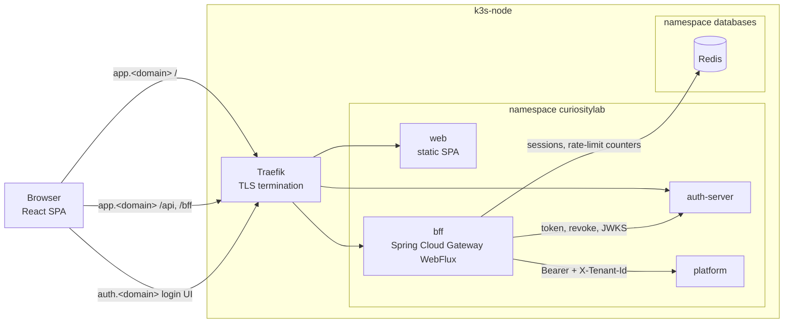
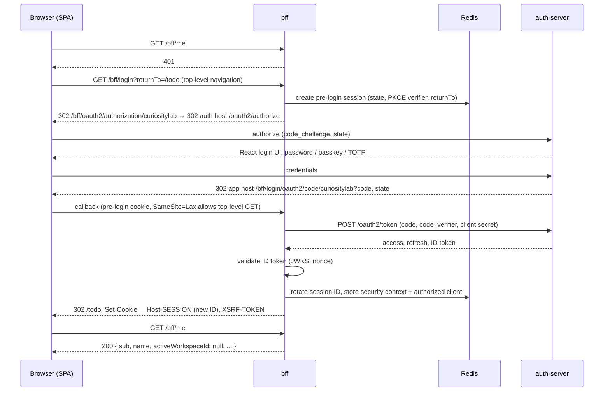
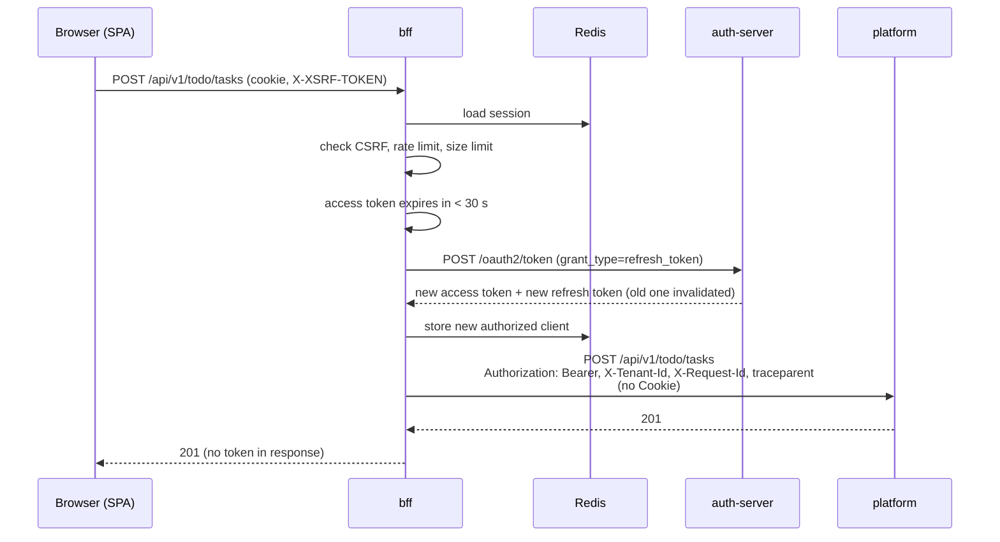
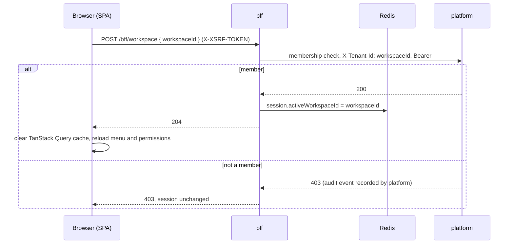
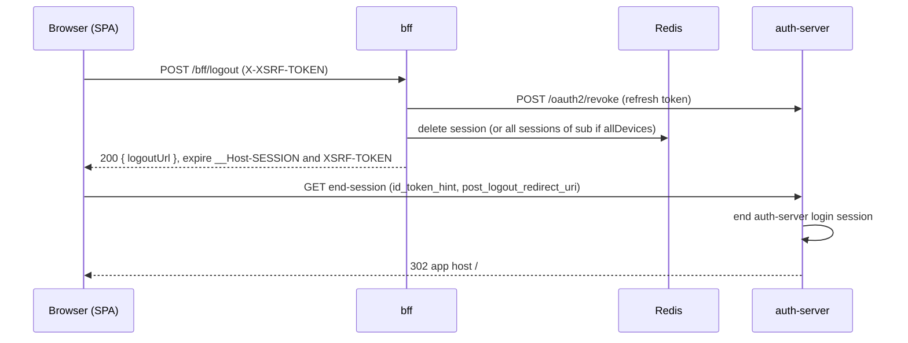
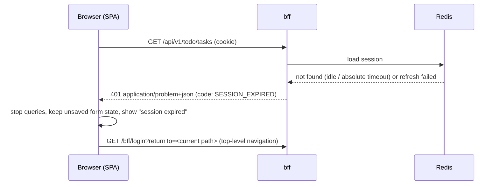

# CuriosityLab — bff Architecture

| Item | Value |
|---|---|
| Document | Backend for Frontend (`bff` deployable) |
| Version | 0.1 (Draft) |
| Status | In review |
| Owner | Architect |
| Last updated | 2026-11-03 |
| Related | [`adr/`](adr/), [`../shared/architecture.md`](../shared/architecture.md), [`../identity/architecture.md`](../identity/architecture.md) |

> **Purpose.** This document describes how the `bff` deployable is built: the browser session, token handling, routing to back-end services, CSRF and edge protection. Conventions shared by every deployable (build, deployment, secrets, observability stack, tenancy) are described once in the [shared architecture](../shared/architecture.md) and are only linked here. **Why** a choice was made is recorded in an ADR. When a decision changes, a new ADR is written and this document is updated to match.

---

## Table of Contents

1. [Responsibilities](#1-responsibilities)
2. [Context](#2-context)
3. [Technology](#3-technology)
4. [Internal Structure](#4-internal-structure)
5. [Session and Cookie Design](#5-session-and-cookie-design)
6. [Token Handling](#6-token-handling)
7. [Routing](#7-routing)
8. [bff Endpoints](#8-bff-endpoints)
9. [Key Flows](#9-key-flows)
10. [CSRF](#10-csrf)
11. [Edge Protection](#11-edge-protection)
12. [Hosting and Deployment](#12-hosting-and-deployment)
13. [Observability](#13-observability)
14. [Resource Budget](#14-resource-budget)
15. [ADR Index](#15-adr-index)
16. [Risks and Technical Debt](#16-risks-and-technical-debt)
17. [Open Items](#17-open-items)

---

## 1. Responsibilities

### 1.1 What the bff does

| Responsibility | Detail |
|---|---|
| Browser session | Server-side session in Redis; the browser holds only an `HttpOnly` session cookie ([ADR-BFF-0001](adr/0001-backend-for-frontend-tokens-stay-server-side.md), [ADR-BFF-0003](adr/0003-sessions-in-redis-with-spring-session.md)) |
| OIDC client | Confidential client of `auth-server`: authorization code + PKCE, client secret from Vault via ESO |
| Token storage and refresh | Access, refresh and ID tokens kept in the session; access token refreshed transparently with refresh-token rotation |
| Routing | Proxies `/api/**` (and later WebSocket and SSE routes) to back-end services with the access token attached ([ADR-BFF-0002](adr/0002-spring-cloud-gateway-webflux.md)) |
| Active workspace | Holds the selected workspace in the session and forwards it as `X-Tenant-Id` ([ADR-BFF-0004](adr/0004-active-workspace-in-session.md)) |
| CSRF | Cookie-to-header token for every state-changing request ([ADR-BFF-0005](adr/0005-csrf-and-same-origin-spa-hosting.md)) |
| Edge protection | Rate limiting, request size limits, security headers on its own responses ([ADR-BFF-0006](adr/0006-edge-rate-limiting-and-security-headers.md)) |
| Logout | Local session invalidation, refresh-token revocation, RP-initiated logout ([ADR-BFF-0007](adr/0007-logout-and-session-termination.md)) |
| Correlation | Request ID and W3C trace context propagated to every upstream call |

### 1.2 What the bff does not do

| Not in the bff | Where it lives |
|---|---|
| Permission checks, RBAC/ABAC, data scope | `platform` (`member` module); permissions are not in the JWT ([ADR-IDENTITY-0003](../identity/adr/0003-permissions-resolved-by-platform-not-in-jwt.md)) |
| Tenant membership verification | `platform`, on every request ([Shared architecture: §7.3](../shared/architecture.md#73-multi-tenancy)) |
| Business logic, validation of business data | `platform` modules |
| Database access | None. The bff has no database and no Flyway migrations |
| Response aggregation or composition ("API composition") | None. One browser request maps to one upstream request |
| Audit record of truth | `audit` module in `platform`; the bff only writes structured logs |
| Login UI, credentials, MFA, passkeys | `auth-server` ([Identity architecture](../identity/architecture.md)) |
| Serving the SPA | Static `web` container ([§12](#12-hosting-and-deployment)) |

The bff is deliberately thin: if a feature needs data, it belongs in `platform`.

---

## 2. Context



| Peer | Interaction |
|---|---|
| Browser | Session cookie and CSRF header only; never receives tokens |
| `auth-server` | Authorization endpoint (browser redirect), token endpoint, revocation endpoint, end-session endpoint, JWKS for ID token validation |
| `platform` | All `/api/**` traffic, with `Authorization: Bearer` and `X-Tenant-Id` |
| Redis | Spring Session store and rate-limit buckets ([Shared architecture: §3](../shared/architecture.md#3-containers)) |
| Vault (through ESO) | OIDC client secret only ([ADR-SHARED-0010](../shared/adr/0010-secrets-with-external-secrets-operator.md)) |

---

## 3. Technology

Versions follow [ADR-SHARED-0004](../shared/adr/0004-runtime-framework-and-build-versions.md); the bff adds no platform-wide choices.

| Concern | Technology |
|---|---|
| Runtime | Java 17, Spring Boot 4.x, reactive stack (Reactor Netty) |
| Gateway | Spring Cloud Gateway Server WebFlux ([ADR-BFF-0002](adr/0002-spring-cloud-gateway-webflux.md)) |
| Security | Spring Security 7 reactive: `oauth2Login`, `oauth2Client`, CSRF, headers |
| Session | Spring Session Data Redis (reactive) ([ADR-BFF-0003](adr/0003-sessions-in-redis-with-spring-session.md)) |
| Redis client | Lettuce (reactive) |
| Rate limiting | Spring Cloud Gateway `RequestRateLimiter` with `RedisRateLimiter` |
| Observability | Micrometer, Micrometer Tracing with OpenTelemetry bridge |
| Testing | JUnit 5, Spring Boot Test, `WebTestClient`, Testcontainers (Redis), WireMock or a stub auth-server for OIDC flows |

Not used: Spring MVC, Spring Data JPA, Flyway, Spring Modulith (no business modules).

---

## 4. Internal Structure

Root package `com.curiositylab.bff`. Packages are plain Java packages; there are no Modulith modules, but ArchUnit enforces that `routing` and `endpoints` do not depend on each other.

```
com.curiositylab.bff/
├── BffApplication.java
├── security/      # SecurityWebFilterChain, oauth2Login, entry points (401 vs redirect),
│                  # CSRF config, authorized-client manager, refresh handling
├── session/       # Cookie resolver (__Host-SESSION), absolute-timeout filter,
│                  # session attributes (active workspace, created-at), logout-all support
├── routing/       # Route definitions, TokenRelay, header filters
│                  # (strip Cookie / Authorization / X-Tenant-Id, add X-Tenant-Id, X-Request-Id)
├── endpoints/     # /bff/me, /bff/login, /bff/logout, /bff/workspace handlers
└── edge/          # Rate-limit key resolvers, request size limits, security headers,
                   # request ID, access log
```

| Package | Depends on |
|---|---|
| `security` | `session` |
| `session` | — |
| `routing` | `session`, `edge` |
| `endpoints` | `security`, `session` |
| `edge` | — |

---

## 5. Session and Cookie Design

### 5.1 Session cookie

| Attribute | Value | Reason |
|---|---|---|
| Name | `__Host-SESSION` | `__Host-` prefix forces `Secure`, `Path=/` and no `Domain`, so the cookie cannot be set or read by `auth.<domain>` or any other subdomain |
| `HttpOnly` | yes | Not readable by JavaScript |
| `Secure` | yes | HTTPS only (TLS at Traefik) |
| `SameSite` | `Lax` | Sent on top-level navigations (needed for the OIDC callback), not on cross-site subrequests ([ADR-BFF-0005](adr/0005-csrf-and-same-origin-spa-hosting.md)) |
| `Path` | `/` | Required by the `__Host-` prefix |
| `Max-Age` | not set (browser-session cookie) | Lifetime is enforced server-side |
| Value | Opaque random session ID | Contains no user data |

### 5.2 Session contents (Redis)

| Attribute | Content |
|---|---|
| Security context | `OAuth2AuthenticationToken` (principal = OIDC `sub`, ID token claims) |
| Authorized client | `OAuth2AuthorizedClient`: access token, refresh token, expiry ([§6](#6-token-handling)) |
| `activeWorkspaceId` | UUID of the selected workspace, or absent ([ADR-BFF-0004](adr/0004-active-workspace-in-session.md)) |
| `createdAt` | Session creation time, for the absolute timeout |
| CSRF token | Server-side copy for the cookie-to-header check (if not stateless; see [§10](#10-csrf)) |

Redis is not backed up; losing it logs every user out and is acceptable ([Shared architecture: §13](../shared/architecture.md#13-backup-and-recovery)).

### 5.3 Timeouts (Proposed values)

| Timeout | Value | Enforcement |
|---|---|---|
| Idle timeout | 30 min | Spring Session max inactive interval (Redis TTL renewed on each request) |
| Absolute timeout | 8 h | Custom `WebFilter` in `session/` compares `createdAt` with now and invalidates the session |
| Access token | 5 min | Issued by auth-server ([ADR-IDENTITY-0002](../identity/adr/0002-session-for-login-tokens-for-services.md)) |
| Refresh token | Rotating; absolute lifetime ≤ absolute session timeout | Issued by auth-server ([ADR-IDENTITY-0002](../identity/adr/0002-session-for-login-tokens-for-services.md)) |
| Session ID rotation | At login | Prevents session fixation |

Long-lived WebSocket and SSE connections do not renew the idle timeout by themselves (OI-BFF-03).

---

## 6. Token Handling

- Tokens are stored only in the session as an `OAuth2AuthorizedClient`, through a session-backed `ServerOAuth2AuthorizedClientRepository`. They are never written to logs, response bodies or cookies.
- The `ReactiveOAuth2AuthorizedClientManager` is configured with the `authorization_code` and `refresh_token` providers. When the access token is within a clock-skew window (30 s) of expiry, it is refreshed before the request is proxied.
- auth-server rotates refresh tokens (reuse disabled). The new refresh token replaces the old one in the session atomically with the new access token.
- A failed refresh (`invalid_grant`: revoked, expired or reused token) removes the authorized client, invalidates the session and returns `401` to the SPA.
- Routes use the gateway `TokenRelay` filter, which reads the authorized client and sets `Authorization: Bearer <access token>`.
- Before proxying, the bff removes `Cookie`, any browser-supplied `Authorization`, and any browser-supplied `X-Tenant-Id`. Upstream services never see the session cookie or the CSRF cookie.
- Concurrent requests that find an expired token at the same time could both try to refresh with the same refresh token; with rotation the second attempt fails. Refresh is serialised per session (see [§16](#16-risks-and-technical-debt)).
- The ID token is kept for `id_token_hint` at RP-initiated logout ([ADR-BFF-0007](adr/0007-logout-and-session-termination.md)).

---

## 7. Routing

### 7.1 Route table

| Route ID | Path | Upstream | Filters | Status |
|---|---|---|---|---|
| `platform-api` | `/api/**` | `platform` service | `TokenRelay`, strip `Cookie` / `Authorization` / `X-Tenant-Id`, add `X-Tenant-Id`, `RequestRateLimiter`, `RequestSize` | Current |
| `comms-api` | `/api/comms/**` | `platform` (later `comms` deployable) | as `platform-api` | Planned |
| `comms-ws` | `/ws/**` | `platform` (later `comms`), `ws://` | `TokenRelay` on the upgrade request, Origin check, strip `Cookie`, add `X-Tenant-Id`, connection rate limit | Planned |
| `ai-api` | `/api/ai/**` | `platform` (later `ai`) | as `platform-api`; SSE responses streamed without buffering, longer response timeout | Planned |

- Routes are defined in Java (`routing/`), not in YAML, so they are covered by tests.
- More specific routes are ordered before `/api/**`, so extracting `comms` or `ai` into its own deployable changes only the upstream URI.
- Paths are not rewritten: `/api/v1/...` is forwarded unchanged ([Shared architecture: §5.6](../shared/architecture.md#56-api-conventions)).
- Upstream URIs are in-cluster service names over plain HTTP inside the namespace, restricted by `NetworkPolicy` ([Shared architecture: §9](../shared/architecture.md#9-security-architecture)).

### 7.2 Timeouts

| Kind | Connect | Response |
|---|---|---|
| REST (`/api/**`) | 2 s | 30 s |
| SSE (`/api/ai/**`) | 2 s | none per event; idle limit 5 min (Proposed) |
| WebSocket (`/ws/**`) | 2 s | none; ping/pong keep-alive |

---

## 8. bff Endpoints

All bff-owned paths live under `/bff/**`, because Traefik routes only `/api` and `/bff` on `app.<domain>` to the bff. This includes the Spring Security OAuth2 paths, which are moved from their defaults (OI-BFF-01):

| Default path | bff path |
|---|---|
| `/oauth2/authorization/{registrationId}` | `/bff/oauth2/authorization/curiositylab` |
| `/login/oauth2/code/{registrationId}` (redirect URI) | `/bff/login/oauth2/code/curiositylab` |

### 8.1 `GET /bff/me`

Returns who is logged in, from the session only (no upstream call). `401` without a body when there is no valid session. Never returns tokens.

| Field | Type | Source |
|---|---|---|
| `authenticated` | boolean | Security context (always `true` on `200`) |
| `sub` | string (UUID) | ID token `sub` = `account_id` ([ADR-IDENTITY-0004](../identity/adr/0004-account-and-member-data-ownership.md)) |
| `name` | string | ID token `name` |
| `email` | string | ID token `email` |
| `emailVerified` | boolean | ID token `email_verified` |
| `locale` | string, optional | ID token `locale` |
| `activeWorkspaceId` | string (UUID) or `null` | Session `activeWorkspaceId` |
| `sessionExpiresAt` | ISO-8601 | `createdAt` + absolute timeout |
| `idleTimeoutSeconds` | integer | Session max inactive interval |

Workspace list, member profile and permissions are not in `/bff/me`; the SPA fetches them from `platform` (`/api/v1/...`), which owns that data.

### 8.2 `GET /bff/login`

- Top-level navigation, not an XHR. Optional `returnTo` query parameter.
- `returnTo` must be a relative path on the same origin (starts with `/`, not `//`); anything else is replaced by `/` to prevent open redirects.
- Saves `returnTo` in the session and redirects to `/bff/oauth2/authorization/curiositylab`, which starts authorization code + PKCE.

### 8.3 `POST /bff/logout`

- CSRF-protected. Optional body `{ "allDevices": true }`.
- Invalidates the session, revokes the refresh token at auth-server, and responds `200` with `{ "logoutUrl": "<auth-server end-session URL>" }`. The SPA navigates there to end the auth-server session ([ADR-BFF-0007](adr/0007-logout-and-session-termination.md)).
- Returning a URL instead of a `302` keeps the endpoint usable from `fetch`, which cannot follow cross-origin redirects visibly.

### 8.4 `POST /bff/workspace`

- CSRF-protected. Body `{ "workspaceId": "<uuid>" }`.
- The bff calls one platform endpoint with that `X-Tenant-Id` to confirm membership; only on `200` it stores `activeWorkspaceId` in the session and returns `204`. On `403` it returns `403` and leaves the session unchanged ([ADR-BFF-0004](adr/0004-active-workspace-in-session.md)).
- This is a pass-through check, not aggregation; platform still verifies membership on every later request.

---

## 9. Key Flows

### 9.1 Login



### 9.2 API call with token refresh



The non-refresh case is [Shared architecture: §8.1](../shared/architecture.md#81-authenticated-api-request).

### 9.3 Workspace switch



### 9.4 Logout



### 9.5 Session expiry seen by the SPA



- For `/api/**`, `/bff/me` and `/ws/**` the entry point returns `401`, never a `302` to the login page; XHR cannot follow a cross-origin redirect usefully.
- Only `/bff/login` starts the redirect to auth-server.
- If auth-server still has a login session, the user returns without entering credentials.

---

## 10. CSRF

- Cookie-to-header pattern: the bff sets `XSRF-TOKEN` (readable by JavaScript, `Secure`, `SameSite=Lax`, `Path=/`); the SPA sends it back as `X-XSRF-TOKEN` on every `POST`, `PUT`, `PATCH`, `DELETE`.
- Applies to `/api/**` and `/bff/**`. Safe methods (`GET`, `HEAD`, `OPTIONS`) are not checked and must not change state.
- `SameSite=Lax` on the session cookie is a second layer, not a replacement.
- WebSocket upgrade requests cannot carry a custom header from the browser API, so the bff checks the `Origin` header against `https://app.<domain>` on `/ws/**`.
- The SPA and the API are on the same origin, so there is no CORS configuration at all; cross-origin requests are rejected by default.
- The token is BREACH-protected (masked per response) where Spring Security's reactive SPA support allows it (verify against current docs).

See [ADR-BFF-0005](adr/0005-csrf-and-same-origin-spa-hosting.md).

---

## 11. Edge Protection

### 11.1 Rate limits (Proposed values)

| Key | Scope | Limit | Response |
|---|---|---|---|
| Client IP | `/bff/login`, OAuth2 callback | 10 / min, burst 20 | `429` + `Retry-After` |
| Client IP | all routes | 300 / min, burst 100 | `429` |
| Session ID (hashed) | `/api/**` | 600 / min, burst 200 | `429` |
| Session ID (hashed) | `/ws/**` new connections | 10 / min | `429` |

- Counters live in Redis (`RedisRateLimiter`, token bucket), so they are shared across replicas.
- The client IP is taken from `X-Forwarded-For` only as set by Traefik (trusted proxy list); browser-supplied values are ignored.
- Credential rate limiting and lockout are in auth-server ([ADR-IDENTITY-0005](../identity/adr/0005-password-hashing-and-account-protection.md)); the bff limit is coarse protection only.

### 11.2 Size limits

| Limit | Value |
|---|---|
| Request body, `/api/**` | 1 MB (`RequestSize` filter) |
| Request headers total | 16 KB |
| WebSocket frame | 64 KB |
| File uploads | Not through the bff: presigned URLs direct to MinIO (`storage` module) |

### 11.3 Security headers on bff responses

| Header | Value |
|---|---|
| `Strict-Transport-Security` | `max-age=31536000; includeSubDomains` |
| `Content-Security-Policy` | `default-src 'none'; frame-ancestors 'none'` (bff responses are JSON) |
| `X-Content-Type-Options` | `nosniff` |
| `Referrer-Policy` | `strict-origin-when-cross-origin` |
| `Cache-Control` | `no-store` on `/bff/**` and `/api/**` (unless upstream sets cacheable headers deliberately) |

The document CSP for the SPA (`default-src 'self'; frame-ancestors 'none'; ...`) is set by the `web` container or a Traefik middleware, because the HTML is not served by the bff (OI-BFF-02). See [ADR-BFF-0006](adr/0006-edge-rate-limiting-and-security-headers.md).

---

## 12. Hosting and Deployment

| Host (placeholder) | Path | Target |
|---|---|---|
| `app.<domain>` | `/` | `web` (static SPA) |
| `app.<domain>` | `/api`, `/bff` | `bff` |
| `auth.<domain>` | `/` | `auth-server` |

- Same origin for SPA and API, so no CORS and `SameSite=Lax` works ([ADR-BFF-0005](adr/0005-csrf-and-same-origin-spa-hosting.md)). Domain names are shared OI-01.
- `auth.<domain>` is a different origin but the same site, which is why the session cookie uses `__Host-` (not shared with `auth.<domain>`).
- The bff reaches `auth-server` and `platform` through in-cluster services; the token issuer must still be `https://auth.<domain>` (OI-BFF-04).
- Deployment, secrets and namespaces follow the shared conventions ([Shared architecture: §10](../shared/architecture.md#10-deployment-architecture), [ADR-SHARED-0009](../shared/adr/0009-gitops-with-argo-cd.md), [ADR-SHARED-0010](../shared/adr/0010-secrets-with-external-secrets-operator.md), [ADR-SHARED-0011](../shared/adr/0011-kubernetes-namespaces.md)).
- The only secret is the OIDC client secret; the Redis password, if any, also comes through ESO.
- The bff is stateless apart from Redis; it can run with more than one replica without sticky sessions. The lab runs one replica.
- Actuator endpoints are on a separate management port, not routed by Traefik.

---

## 13. Observability

Signals follow [Shared architecture: §12](../shared/architecture.md#12-observability) and [ADR-SHARED-0012](../shared/adr/0012-observability-with-grafana-stack.md).

| Signal | bff specifics |
|---|---|
| Request ID | `X-Request-Id` accepted from Traefik if well-formed, otherwise generated; forwarded upstream and returned to the browser |
| Traces | W3C `traceparent` started or continued by the bff and propagated to platform and auth-server |
| Access log | One JSON line per request: method, route ID, path without query string, status, duration, request ID, trace ID, hashed session ID, `sub` |
| Metrics | Gateway route metrics (count, latency per route and status), token refresh success/failure, rate-limit rejections, active sessions (approx.), Redis latency |
| Security events (logs) | Login success/failure at callback, refresh failure, logout, CSRF rejection, rate-limit rejection. Records of truth are in `audit` |

Never logged: cookies, `Authorization`, tokens, raw session IDs, CSRF tokens, request bodies.

---

## 14. Resource Budget

| Item | Value |
|---|---|
| Memory request / limit | 256 MiB / 384 MiB |
| JVM | `-XX:MaxRAMPercentage=70`, Reactor Netty default event loops |
| CPU request / limit | 100m / 500m |
| Replicas (lab) | 1 |

Part of the ~1.8 GB for the three Spring deployables in [Shared architecture: §10.3](../shared/architecture.md#103-resource-budget). Redis memory is counted in the shared budget.

---

## 15. ADR Index

See [`adr/README.md`](adr/README.md).

| ADR | Title | Status |
|---|---|---|
| [0001](adr/0001-backend-for-frontend-tokens-stay-server-side.md) | Backend for Frontend, tokens stay server-side | Accepted |
| [0002](adr/0002-spring-cloud-gateway-webflux.md) | Spring Cloud Gateway Server WebFlux | Proposed |
| [0003](adr/0003-sessions-in-redis-with-spring-session.md) | Sessions in Redis with Spring Session | Accepted |
| [0004](adr/0004-active-workspace-in-session.md) | Active workspace in the session | Proposed |
| [0005](adr/0005-csrf-and-same-origin-spa-hosting.md) | CSRF protection and same-origin SPA hosting | Proposed |
| [0006](adr/0006-edge-rate-limiting-and-security-headers.md) | Edge rate limiting and security headers | Proposed |
| [0007](adr/0007-logout-and-session-termination.md) | Logout and session termination | Proposed |

---

## 16. Risks and Technical Debt

| Risk | Impact | Mitigation |
|---|---|---|
| Concurrent refresh with rotating refresh tokens | Second refresh fails with `invalid_grant`, user logged out unexpectedly | Serialise refresh per session (in-process lock plus short Redis lock); integration test with parallel requests |
| Redis outage | Every request returns `401`; nobody can log in | Accepted for a lab; sessions are disposable; Redis readiness in bff health check |
| WebSocket token expiry | Connection outlives the 5-min access token and the session | Platform validates at handshake; bff closes WebSocket connections when the session ends (OI-BFF-03) |
| Gateway WebFlux and Spring Session reactive behaviour changes across Spring Boot 4.x minors | Subtle breakage in session or refresh handling | Integration tests for login, refresh, expiry, logout; pin versions in the catalog |
| bff grows business logic or aggregation | Second place for rules; harder to extract modules | Review rule: no DB, no aggregation; ArchUnit forbids JPA and JDBC on the classpath |
| Reactive programming unfamiliar to readers of the book | Harder teaching | Keep custom code small; most behaviour is configuration |

---

## 17. Open Items

| ID | Item | Owner |
|---|---|---|
| OI-BFF-01 | Confirm moving OAuth2 authorization and callback paths under `/bff/**`, or add `/login/oauth2/**` and `/oauth2/**` to the Traefik route for the bff | Architect |
| OI-BFF-02 | Who sets the document CSP and HSTS for `/` (web container config or Traefik middleware) | Architect |
| OI-BFF-03 | WebSocket and SSE behaviour at session end and token expiry; whether activity on them renews the idle timeout | Architect |
| OI-BFF-04 | bff → auth-server path: hairpin through Traefik (`auth.<domain>`) or in-cluster service with explicit endpoint URIs while keeping the issuer `https://auth.<domain>` | Architect |
| OI-BFF-05 | Final idle/absolute timeout values and alignment with refresh-token lifetime (ADR-IDENTITY-0002) | Owner |
| OI-BFF-06 | OIDC back-channel logout from auth-server to the bff (in addition to RP-initiated logout) | Architect |
| OI-06 (shared) | Redis: dedicated instance or shared with other lab workloads | Owner |
