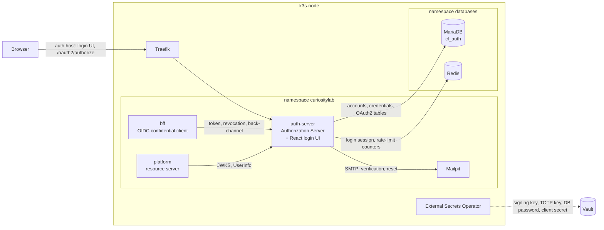
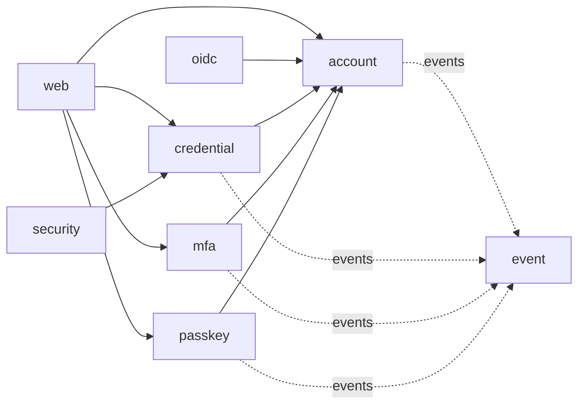
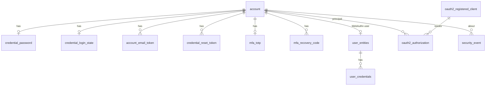
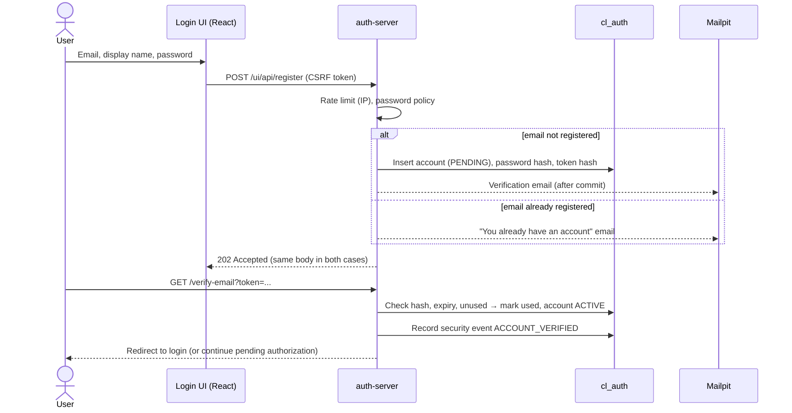
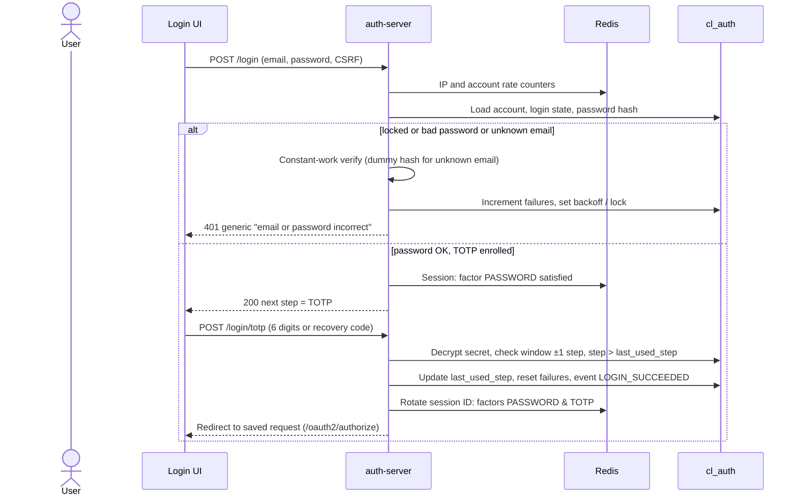
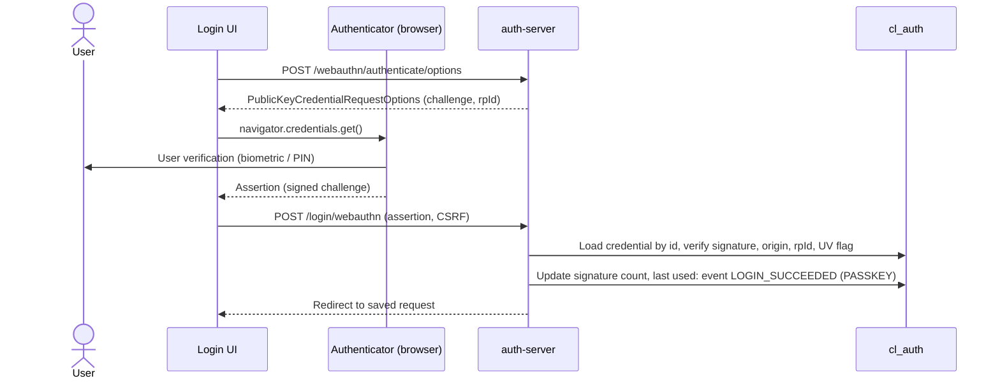
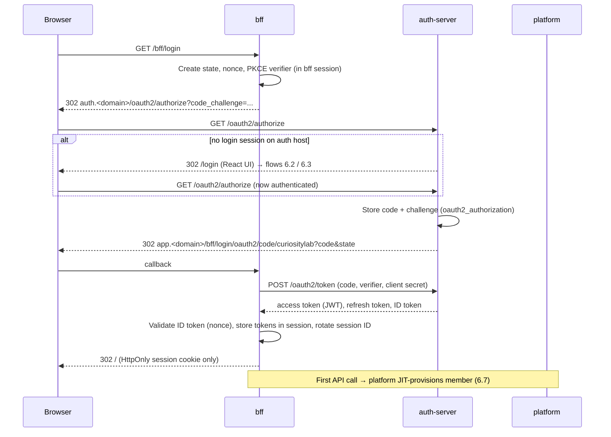

# CuriosityLab — Identity Architecture (`auth-server`)

| Item | Value |
|---|---|
| Document | Identity module and `auth-server` deployable |
| Version | 0.1 (Draft) |
| Status | In review |
| Owner | Architect |
| Last updated | 2026-11-03 |
| Related | [`adr/`](adr/), [`../shared/architecture.md`](../shared/architecture.md), [`../bff/architecture.md`](../bff/architecture.md), [`prd.md`](prd.md) |

> **Purpose.** This document describes how the `auth-server` deployable is built: what identity owns, its internal structure, its data, its authentication and OIDC flows, its tokens and its security controls. Conventions shared by every deployable (module rules, data conventions, deployment, CI/CD, observability stack) are defined once in the [shared architecture](../shared/architecture.md) and are only linked here. **Why** a choice was made is recorded in an ADR in [`adr/`](adr/README.md). When a decision changes, a new ADR is written and this document is updated to match.

---

## Table of Contents

1. [Scope and Responsibilities](#1-scope-and-responsibilities)
2. [Context and Containers](#2-context-and-containers)
3. [Technology](#3-technology)
4. [Component Structure](#4-component-structure)
5. [Data Model (`cl_auth`)](#5-data-model-cl_auth)
6. [Key Flows](#6-key-flows)
7. [Token Design](#7-token-design)
8. [Security Controls](#8-security-controls)
9. [Login UI](#9-login-ui)
10. [Deployment and Configuration](#10-deployment-and-configuration)
11. [Observability](#11-observability)
12. [ADR Index](#12-adr-index)
13. [Risks and Technical Debt](#13-risks-and-technical-debt)
14. [Open Items](#14-open-items)

---

## 1. Scope and Responsibilities

Identity answers one question: **who is this person, and have they proven it?** It does not answer what they may do, or in which workspace.

### 1.1 Owned by identity (`auth-server`)

| Responsibility | Notes |
|---|---|
| Accounts | One account per person, global (not tenant-scoped); login identifier is the verified email |
| Registration and email verification | Self-registration; account is usable only after the email is verified ([ADR-IDENTITY-0009](adr/0009-email-verification-and-lab-mail-with-mailpit.md)) |
| Password credentials | Argon2id hashes, password change and reset ([ADR-IDENTITY-0005](adr/0005-password-hashing-and-account-protection.md)) |
| Multi-factor authentication | TOTP (RFC 6238) and single-use recovery codes ([ADR-IDENTITY-0006](adr/0006-totp-two-factor-with-recovery-codes.md)) |
| Passkeys | WebAuthn, passwordless login and second factor ([ADR-IDENTITY-0007](adr/0007-passkeys-with-spring-security-webauthn.md)) |
| Login session on the auth host | Server-side session that remembers "this browser has authenticated" for SSO ([ADR-IDENTITY-0002](adr/0002-session-for-login-tokens-for-services.md)) |
| OIDC provider | Authorization endpoint, token endpoint, JWKS, UserInfo, discovery, revocation, RP-initiated logout ([ADR-IDENTITY-0001](adr/0001-self-hosted-spring-authorization-server.md)) |
| Account protection | Lockout/backoff, rate limiting, no account enumeration |
| Login UI | React bundle served by `auth-server` ([ADR-IDENTITY-0008](adr/0008-react-login-ui-served-by-auth-server.md)) |
| Security events | Emits authentication events (login success/failure, MFA changes, lockout) for the audit trail |

### 1.2 Not identity

| Concern | Owner |
|---|---|
| Members of a workspace, profile used inside the product, departments, groups | `member` module in `platform` |
| Roles, permissions, ABAC attributes, data scope | `member` module in `platform` ([ADR-IDENTITY-0003](adr/0003-permissions-resolved-by-platform-not-in-jwt.md)) |
| Workspaces (tenants), active workspace selection | `tenant` module in `platform`; active workspace held by the bff ([ADR-BFF-0004](../bff/adr/0004-active-workspace-in-session.md)) |
| Browser session for the SPA, token storage, refresh | `bff` ([ADR-BFF-0001](../bff/adr/0001-backend-for-frontend-tokens-stay-server-side.md)) |
| Audit record of truth | `audit` module in `platform` |
| Product notifications | `notification` module in `platform` |

The link between the two worlds is a single value: **`account_id` = OIDC `sub`**. Platform creates its member profile just in time on the first authenticated request ([ADR-IDENTITY-0004](adr/0004-account-and-member-data-ownership.md)).

---

## 2. Context and Containers

The system context and the full container view are in [Shared architecture: §2–§3](../shared/architecture.md#3-containers). The view below shows only the flows that touch `auth-server`.



| Caller → auth-server | Purpose | Protocol |
|---|---|---|
| Browser | Login UI, registration, MFA, passkey ceremonies, `/oauth2/authorize`, logout | HTTPS on `auth.<domain>` |
| bff | Code exchange, refresh, revocation, end-session redirect target | HTTPS (in-cluster service), client authentication with secret |
| platform | JWKS for JWT validation; UserInfo for JIT provisioning | HTTPS (in-cluster service) |

| auth-server → | Purpose |
|---|---|
| MariaDB `cl_auth` | System of record for identity ([Shared architecture: §7.1](../shared/architecture.md#71-databases)) |
| Redis | Spring Session store for the login session; rate-limit and lockout counters |
| Mailpit (SMTP) | Verification and reset email in the lab; outbound relay deferred |

---

## 3. Technology

Only identity-specific choices are listed; the common stack is in [Shared architecture: §4](../shared/architecture.md#4-technology-stack).

| Concern | Technology |
|---|---|
| OIDC / OAuth 2.1 provider | Spring Authorization Server (line aligned with Spring Security 7) |
| Authentication | Spring Security 7: form login, WebAuthn support, multi-factor authentication support (verify current API) |
| Password hashing | `Argon2PasswordEncoder` (Bouncy Castle) wrapped in `DelegatingPasswordEncoder` |
| TOTP | RFC 6238 implementation (small library or own code, see [ADR-IDENTITY-0006](adr/0006-totp-two-factor-with-recovery-codes.md)) |
| Login session | Spring Session Data Redis (servlet) |
| Persistence | Spring Data JPA + Hibernate 7 for identity tables; Spring JDBC for framework tables (Authorization Server, WebAuthn) |
| Mail | Spring Boot mail starter (SMTP) |
| Login UI | React + TypeScript + MUI, built with Vite into `static/` ([ADR-SHARED-0013](../shared/adr/0013-react-for-all-user-interfaces.md)) |

---

## 4. Component Structure

`auth-server` is a single Spring Boot application with the base package `com.curiositylab.auth`. Its packages follow the same module rules as platform ([Shared architecture: §5.4](../shared/architecture.md#54-package-layout-inside-a-module)): each top-level package has a small public API and an `internal/` package, and `ApplicationModules.verify()` runs in the test suite.

```
com.curiositylab.auth/
├── account/      # Account lifecycle: register, verify email, status, profile (email, display name)
├── credential/   # Password: hash, verify, change, reset; lockout and backoff state
├── mfa/          # TOTP enrolment and verification; recovery codes
├── passkey/      # WebAuthn registration and authentication; credential store adapters
├── oidc/         # Authorization Server config, registered clients, token customizer, logout
├── security/     # SecurityFilterChains, rate limiting, generic error handling
├── event/        # Security event publication (outbox) for the audit trail
└── web/          # Login UI controller (serves the React bundle), JSON endpoints for the UI
```



| Package | Responsibility | Depends on |
|---|---|---|
| `account` | Account aggregate, status (`PENDING`, `ACTIVE`, `LOCKED`, `DISABLED`), email verification tokens | — |
| `credential` | `PasswordEncoder`, password policy, failed-attempt counters, reset tokens | `account` |
| `mfa` | TOTP secret (encrypted), recovery codes (hashed), second-factor step | `account` |
| `passkey` | Spring Security WebAuthn repositories mapped to `cl_auth`, passkey management UI endpoints | `account` |
| `oidc` | Authorization Server filter chain, `RegisteredClientRepository` (JDBC), `OAuth2AuthorizationService` (JDBC), JWT customizer, JWK source | `account` |
| `security` | Two filter chains (Authorization Server endpoints, login/UI endpoints), rate limiter, enumeration-safe responses | `credential` |
| `event` | Records security events in the same transaction (outbox) | — |
| `web` | `GET /login`, `/register`, … return the SPA shell; `/ui/api/**` JSON endpoints for the login UI | all above |

Rules:

1. Only `oidc` touches Authorization Server types; other packages know nothing about OAuth2.
2. `credential`, `mfa` and `passkey` never read each other's tables. The authentication flow is orchestrated by Spring Security's filter chain and multi-factor support, not by cross-package calls.
3. No business data from platform is read or cached here.

---

## 5. Data Model (`cl_auth`)

`cl_auth` holds **no tenant-scoped tables**: accounts are global and the tenant concept belongs to platform. All tables are therefore on the "non-tenant tables" list required by [Shared architecture: §7.3](../shared/architecture.md#73-multi-tenancy). Primary keys follow [ADR-SHARED-0005](../shared/adr/0005-mariadb-database-per-deployable-and-uuid-keys.md) except framework tables, which keep the framework's schema.

### 5.1 Identity tables (owned by CuriosityLab code)

| Table | Content | Notes |
|---|---|---|
| `account` | `id` (UUIDv7, = `sub`), email (unique, normalized), email_verified_at, display_name, status, created/updated columns, `version` | Login identifier is the email |
| `account_email_token` | account_id, purpose (`VERIFY`, `CHANGE_EMAIL`), token hash (SHA-256), expires_at, used_at | Token value never stored |
| `credential_password` | account_id (PK), Argon2id hash string (encoded parameters), changed_at | One row per account; absent for passkey-only accounts |
| `credential_reset_token` | account_id, token hash, expires_at, used_at | Single use, short expiry |
| `credential_login_state` | account_id, failed_count, last_failure_at, locked_until | Backoff and lockout; IP counters live in Redis |
| `mfa_totp` | account_id, secret ciphertext, key id, confirmed_at, last_used_step | Secret encrypted (AES-GCM), not hashed; `last_used_step` blocks replay |
| `mfa_recovery_code` | account_id, code hash, used_at | 10 codes per set; regenerating deletes the old set |
| `security_event` | id, account_id (nullable), type, occurred_at, ip, user agent, outcome, details (JSON) | Append-only outbox for the audit trail (§8.6) |

### 5.2 Framework tables

| Table | Owner | Content |
|---|---|---|
| `user_entities` | Spring Security WebAuthn (JDBC) | WebAuthn user entity: random user handle ↔ account (name = account id) |
| `user_credentials` | Spring Security WebAuthn (JDBC) | Passkey credential id, public key (COSE), signature count, transports, backup flags, label, created/last used |
| `oauth2_registered_client` | Authorization Server | Clients (`bff`), redirect URIs, grant types, scopes, client secret hash, token settings |
| `oauth2_authorization` | Authorization Server | Authorization codes, access/refresh/ID token metadata, state, PKCE challenge |
| `oauth2_authorization_consent` | Authorization Server | Granted scopes per client and principal (unused while only first-party clients exist) |
| `event_publication` | Spring Modulith (if used, see OI-IDN-03) | Outbox for security events |

The Spring Session data for the login session is in Redis, not in `cl_auth`. Exact framework DDL is taken from the framework's published schema scripts and adapted to MariaDB in Flyway migrations; verify column types against the current versions.



---

## 6. Key Flows

The authenticated API request through the bff is in [Shared architecture: §8.1](../shared/architecture.md#81-authenticated-api-request). The bff side of login and logout (session creation, cookie, CSRF) is in [`../bff/architecture.md`](../bff/architecture.md).

### 6.1 Registration and email verification



### 6.2 Password login with TOTP



### 6.3 Passkey login (passwordless)



A passkey with user verification counts as multi-factor on its own; no TOTP step follows. Endpoint paths are the Spring Security defaults; verify against the current docs ([ADR-IDENTITY-0007](adr/0007-passkeys-with-spring-security-webauthn.md)).

### 6.4 OIDC authorization code + PKCE (bff as confidential client)



The consent screen is skipped for the first-party `bff` client.

### 6.5 Token refresh

```mermaid
sequenceDiagram
    participant G as bff
    participant A as auth-server
    participant DB as cl_auth

    G->>G: Access token expires within clock skew
    G->>A: POST /oauth2/token grant_type=refresh_token (client secret)
    A->>DB: Find authorization by refresh token; check not expired / invalidated
    A->>DB: Issue new access + new refresh token; old refresh token invalidated
    A-->>G: New tokens
    G->>G: Replace tokens in session
    Note over G,A: invalid_grant → bff ends its session, user logs in again
```

Refresh-token rotation is enabled by `reuseRefreshTokens(false)` in the client's token settings. Detecting reuse of an old refresh token (and revoking the whole authorization) is not assumed to be built in; verify and add if needed.

### 6.6 Logout (RP-initiated)

```mermaid
sequenceDiagram
    participant B as Browser
    participant G as bff
    participant A as auth-server

    B->>G: POST /bff/logout (CSRF)
    G->>A: POST /oauth2/revoke (refresh token)
    G->>G: Invalidate bff session
    G-->>B: 200 { logoutUrl } (auth.<domain>/connect/logout?id_token_hint&post_logout_redirect_uri)
    B->>A: SPA navigates to logoutUrl: GET /connect/logout
    A->>A: Validate hint and redirect URI; invalidate login session; event LOGOUT
    A-->>B: 302 app.<domain>/ (logged out)
```

The bff answers `200` with the URL instead of a `302`, because the SPA calls `/bff/logout` with `fetch` and cannot usefully follow a cross-origin redirect ([ADR-BFF-0007](../bff/adr/0007-logout-and-session-termination.md)). Access tokens already issued remain valid until they expire (short lifetime, §7). Back-channel logout is not used.

### 6.7 JIT provisioning (identity side)

Platform validates the JWT, sees an unknown `sub`, calls UserInfo with the same access token to get `email` and `name`, and creates its member profile. Identity takes no action and holds no platform state ([ADR-IDENTITY-0004](adr/0004-account-and-member-data-ownership.md)).

### 6.8 Other flows (summary)

| Flow | Outline |
|---|---|
| Password reset | Request (generic response) → emailed single-use token (hash stored, 30 min) → new password → all login sessions and authorizations for the account revoked |
| TOTP enrolment | Re-authenticate → secret generated, shown as QR → confirm with one code → recovery codes shown once |
| Passkey registration | Authenticated user → `/webauthn/register/options` → `navigator.credentials.create()` → stored in `user_credentials` |
| Account disable | Status `DISABLED` → authorizations revoked → refresh fails; bff session ends at next refresh |

---

## 7. Token Design

### 7.1 Claims

| Token | Claims |
|---|---|
| Access token (JWT, audience platform) | `iss`, `sub` (= account id), `aud`, `exp`, `iat`, `nbf`, `jti`, `scope`, `client_id` |
| ID token (to bff only) | `iss`, `sub`, `aud`, `exp`, `iat`, `nonce`, `auth_time`, `amr` (e.g. `pwd`, `otp`, `hwk`), `sid` |
| UserInfo response | `sub`, `email`, `email_verified`, `name` |
| Refresh token | Opaque, stored hashed by the Authorization Server |

Deliberately **not** in any token:

- **Permissions or roles**: resolved by platform per workspace ([ADR-IDENTITY-0003](adr/0003-permissions-resolved-by-platform-not-in-jwt.md)).
- **Tenant id**: the active workspace is in the bff session and forwarded as `X-Tenant-Id` ([ADR-BFF-0004](../bff/adr/0004-active-workspace-in-session.md)).
- **Email in the access token**: platform reads it from UserInfo, so a token never carries stale profile data.

Scopes are coarse API scopes (`openid`, `profile`, `email`, `platform.api`), not permissions.

### 7.2 Lifetimes (Proposed)

| Item | Proposed value |
|---|---|
| Authorization code | 1 min, single use |
| Access token | 5 min |
| ID token | 5 min |
| Refresh token | Rotated on every use; 8 h absolute lifetime of the authorization |
| auth-server login session | Idle 30 min, absolute 8 h |

The refresh-token absolute lifetime bounds the bff session's absolute timeout; both values must be aligned with the bff docs. See [ADR-IDENTITY-0002](adr/0002-session-for-login-tokens-for-services.md).

### 7.3 Signing keys

- Asymmetric signing key (RS256 or ES256, open item OI-IDN-02) from Vault via ESO ([ADR-SHARED-0010](../shared/adr/0010-secrets-with-external-secrets-operator.md)); never generated at startup, so restarts and replicas share keys.
- JWKS publishes the current and the previous key during rotation; `kid` in every token.

---

## 8. Security Controls

Cross-cutting controls (TLS, NetworkPolicy, container hardening, supply chain) are in [Shared architecture: §9](../shared/architecture.md#9-security-architecture). The auth host is **not** behind the bff, so auth-server applies its own edge controls.

### 8.1 Hashing vs encryption

| Data | Treatment | Why |
|---|---|---|
| Password | Argon2id hash (one-way) | Only needs to be verified, never read back |
| Recovery codes, email/reset tokens | SHA-256 hash (high-entropy input) | Verified once; slow hashing not needed for 128+ bit random values |
| TOTP secret | AES-256-GCM encryption, key from Vault via ESO | Must be read back to compute the expected code |
| Passkey | Public key only | Private key never leaves the authenticator |
| Client secret (`bff`) | Hashed in `oauth2_registered_client`; plaintext only in Vault → bff | Standard Authorization Server behaviour |

### 8.2 Account protection

| Control | Implementation (Proposed) |
|---|---|
| Backoff and lockout | Per account: increasing delay after 3 failures; temporary lock (15 min) after 10; never permanent without admin action |
| Rate limiting | Redis counters per IP and per account on `/login`, `/login/totp`, `/ui/api/register`, password reset, `/oauth2/token`; optional Traefik middleware as an outer layer |
| No enumeration | Same response, status and similar timing for known and unknown emails in login, registration and reset; dummy Argon2id verify for unknown emails |
| Session fixation | Session ID rotated after each completed authentication step |
| CSRF | Spring Security CSRF on all state-changing login UI endpoints |
| Clickjacking / headers | CSP (`frame-ancestors 'none'`), HSTS, `Referrer-Policy: no-referrer` on the auth host |
| Redirect URIs | Exact match only, registered per client; PKCE required for every client |
| Re-authentication | Required (recent `auth_time`) before changing password, email, MFA or passkeys |

### 8.3 Audit events emitted

| Event | When |
|---|---|
| `ACCOUNT_REGISTERED`, `ACCOUNT_VERIFIED`, `ACCOUNT_DISABLED` | Account lifecycle |
| `LOGIN_SUCCEEDED`, `LOGIN_FAILED` (with factor, reason code) | Every authentication attempt |
| `ACCOUNT_LOCKED`, `ACCOUNT_UNLOCKED` | Lockout state changes |
| `PASSWORD_CHANGED`, `PASSWORD_RESET_REQUESTED`, `PASSWORD_RESET_COMPLETED` | Password changes |
| `MFA_TOTP_ENROLLED`, `MFA_TOTP_REMOVED`, `RECOVERY_CODE_USED`, `RECOVERY_CODES_REGENERATED` | MFA changes |
| `PASSKEY_REGISTERED`, `PASSKEY_REMOVED` | Passkey changes |
| `TOKEN_ISSUED`, `TOKEN_REFRESHED`, `TOKEN_REVOKED`, `LOGOUT` | OIDC lifecycle |

Events are written to `security_event` in the same transaction as the change (outbox). Delivery to the platform `audit` module, which is the record of truth, crosses deployables and is not yet decided (OI-IDN-03). Events never contain passwords, codes, secrets or tokens.

---

## 9. Login UI

- A separate React + TypeScript + MUI bundle, built with Vite and packaged into the `auth-server` JAR as static resources ([ADR-IDENTITY-0008](adr/0008-react-login-ui-served-by-auth-server.md)).
- Pages: login, TOTP / recovery code step, passkey login, registration, verify-email result, password reset, account security (password, TOTP, passkeys, recovery codes).
- Served from `auth.<domain>`, same origin as the endpoints it calls, so it uses the auth-server session cookie and CSRF cookie-to-header tokens. It holds no tokens.
- Calls Spring Security endpoints (`/login`, `/login/webauthn`, WebAuthn options) and small JSON endpoints under `/ui/api/**`. Errors are RFC 9457 Problem Details with a stable `code` ([Shared architecture: §5.6](../shared/architecture.md#56-api-conventions)).
- Shares MUI theme and i18n (zh-TW first) with `web`; shares no runtime code with the main SPA.
- Strict CSP: no inline scripts, no third-party origins.

---

## 10. Deployment and Configuration

Deployment follows [Shared architecture: §10–§11](../shared/architecture.md#10-deployment-architecture). Identity-specific items:

| Item | Value |
|---|---|
| Namespace | `curiositylab` |
| Replicas | 1 in the lab; stateless apart from Redis and MariaDB, so 2+ is possible |
| Ingress | `auth.<domain>` → auth-server (OI-01 in shared) |
| Secrets via ESO | `cl_auth` DB password, JWT signing key(s), TOTP encryption key, SMTP settings, `bff` client secret (hashed when the client is registered at startup) |
| Issuer URL | `https://auth.<domain>`; must be identical for browser and in-cluster callers |
| Memory | Part of the ~1.8 GB budget for the three deployables |

The issuer must resolve the same way from the browser and from bff/platform inside the cluster (in-cluster calls go to the ingress host, or the issuer is split from the back-channel URL); see OI-IDN-04.

---

## 11. Observability

Signals and pipeline follow [Shared architecture: §12](../shared/architecture.md#12-observability).

| Metric | Use |
|---|---|
| Login attempts by outcome and factor | Credential stuffing detection, MFA adoption |
| Lockouts and rate-limit rejections | Abuse and false-positive tuning |
| Token issuance / refresh / `invalid_grant` | Session health with the bff |
| Argon2id verify latency | Parameter tuning, CPU pressure |
| Mail send failures | Verification flow health |

- Logs and traces never contain passwords, TOTP codes, recovery codes, tokens, session IDs or authorization codes; email addresses are logged only as account id.
- Alert on a spike of `LOGIN_FAILED` across many accounts from few IPs.

---

## 12. ADR Index

See [`adr/README.md`](adr/README.md).

| ADR | Title | Status |
|---|---|---|
| [0001](adr/0001-self-hosted-spring-authorization-server.md) | Self-hosted Spring Authorization Server | Accepted |
| [0002](adr/0002-session-for-login-tokens-for-services.md) | Session for login, tokens for services | Accepted (BFF holds tokens) / Proposed (token lifetimes) |
| [0003](adr/0003-permissions-resolved-by-platform-not-in-jwt.md) | Permissions resolved by platform, not in the JWT | Proposed |
| [0004](adr/0004-account-and-member-data-ownership.md) | Account and member data ownership | Proposed (JIT provisioning) |
| [0005](adr/0005-password-hashing-and-account-protection.md) | Password hashing and account protection | Proposed (Argon2id) |
| [0006](adr/0006-totp-two-factor-with-recovery-codes.md) | TOTP two-factor authentication with recovery codes | Accepted (TOTP) / Proposed (secret encryption, recovery codes) |
| [0007](adr/0007-passkeys-with-spring-security-webauthn.md) | Passkeys with Spring Security WebAuthn | Accepted (passkeys) / Proposed (details) |
| [0008](adr/0008-react-login-ui-served-by-auth-server.md) | React login UI served by auth-server | Accepted |
| [0009](adr/0009-email-verification-and-lab-mail-with-mailpit.md) | Email verification and lab mail with Mailpit | Proposed |

Shared decisions that apply here: [ADR-SHARED-0004](../shared/adr/0004-runtime-framework-and-build-versions.md), [0005](../shared/adr/0005-mariadb-database-per-deployable-and-uuid-keys.md), [0010](../shared/adr/0010-secrets-with-external-secrets-operator.md), [0013](../shared/adr/0013-react-for-all-user-interfaces.md). bff decisions that depend on this one: [ADR-BFF-0001](../bff/adr/0001-backend-for-frontend-tokens-stay-server-side.md), [ADR-BFF-0007](../bff/adr/0007-logout-and-session-termination.md).

---

## 13. Risks and Technical Debt

| Risk | Impact | Mitigation |
|---|---|---|
| Own identity provider written by one developer | Security defects in authentication | Rely on framework features (Authorization Server, WebAuthn, MFA); no custom crypto; ZAP and integration tests for every flow |
| Spring Security 7 MFA / WebAuthn APIs are new | API changes, missing features | Verify against current docs before implementation; keep custom code at the edges |
| Signing key or TOTP key lost or leaked | All tokens forgeable / all TOTP secrets unreadable | Keys only in Vault; rotation procedure with `kid`; TOTP key id stored per row |
| Access tokens cannot be revoked before expiry | A stolen token works up to 5 min | Short lifetime; tokens never reach the browser |
| Mail cannot leave the lab (port 25 blocked) | Real users cannot verify email | Mailpit for the lab; relay over 587/465 later (ADR-IDENTITY-0009) |
| Argon2id cost on 4 shared vCPUs | Slow logins, CPU starvation under attack | Benchmark parameters; rate limit before hashing |
| Audit delivery to platform undecided | Gaps in the audit trail | Local append-only `security_event` table until delivery is built (OI-IDN-03) |

---

## 14. Open Items

| ID | Item | Owner |
|---|---|---|
| OI-IDN-01 | Final token and session lifetimes, aligned with bff idle/absolute timeouts | Owner |
| OI-IDN-02 | Signing algorithm (RS256 vs ES256) and key rotation procedure | Architect |
| OI-IDN-03 | How `security_event` reaches the platform `audit` module (HTTP push with client credentials, pull by platform, or broker) | Architect |
| OI-IDN-04 | Issuer URL resolution for in-cluster callers (hairpin through Traefik vs split back-channel URL) | Architect |
| OI-IDN-05 | Source location of the login UI in the repository (e.g. `backend/auth-server/ui/` vs top-level `auth-ui/`) | Architect |
| OI-IDN-06 | MFA policy: optional, encouraged, or required per workspace (would need a platform → identity signal) | Owner |
| OI-IDN-07 | Outbound mail relay for real delivery (submission port, provider) | Owner |
| OI-IDN-08 | TOTP library vs own implementation | Architect |
