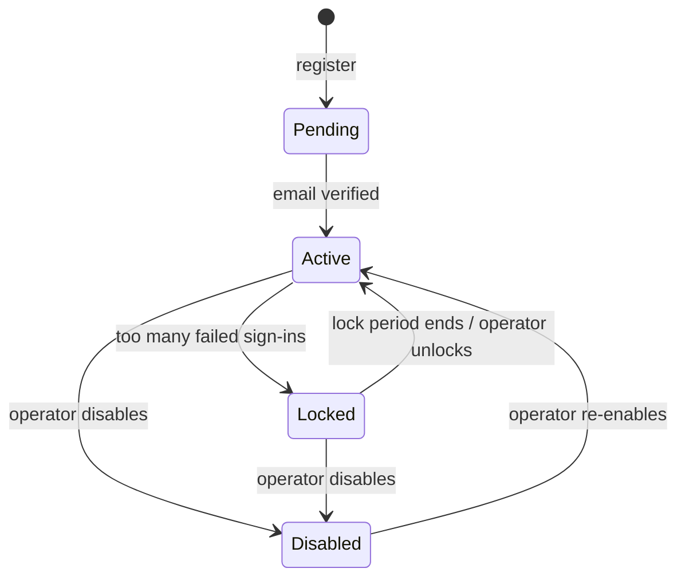

# CuriosityLab — Identity Product Requirements Document (PRD)

| Item | Value |
|---|---|
| Document | PRD — Identity (`auth-server`) |
| Version | 0.1 (Draft) |
| Status | In review |
| Owner | Owner |
| Last updated | 2026-11-03 |
| Related | [`architecture.md`](architecture.md), [`adr/`](adr/README.md), [`../bff/architecture.md`](../bff/architecture.md), [`../shared/architecture.md`](../shared/architecture.md), OpenAPI (generated) |

> **Scope of this document.** This PRD describes *what* identity does and *why*, from the user's and the Owner's point of view. It does not prescribe *how* it is built. Technical choices (Authorization Server, hashing algorithm, session store, token format, etc.) are recorded in [`architecture.md`](architecture.md) and [`adr/`](adr/README.md). Where a value below also appears in an ADR (for example a timeout), the PRD states the requirement and the ADR records why that value was chosen.

---

## Table of Contents

1. [Background and Goals](#1-background-and-goals)
2. [Scope](#2-scope)
3. [Glossary](#3-glossary)
4. [Users and Roles](#4-users-and-roles)
5. [Account Lifecycle](#5-account-lifecycle)
6. [Functional Requirements](#6-functional-requirements)
   - 6.1 [Registration and Email Verification](#61-registration-and-email-verification-idn-reg)
   - 6.2 [Sign-in and Session](#62-sign-in-and-session-idn-auth)
   - 6.3 [Password Management](#63-password-management-idn-pwd)
   - 6.4 [Two-Factor Authentication](#64-two-factor-authentication-idn-mfa)
   - 6.5 [Passkeys](#65-passkeys-idn-pk)
   - 6.6 [Single Sign-On and Sign-out](#66-single-sign-on-and-sign-out-idn-sso)
   - 6.7 [Account Self-Service](#67-account-self-service-idn-acc)
   - 6.8 [Operator Actions](#68-operator-actions-idn-ops)
   - 6.9 [Security Events](#69-security-events-idn-evt)
   - 6.10 [Localization](#610-localization-idn-i18n)
7. [Permission Matrix](#7-permission-matrix)
8. [Non-Functional Requirements](#8-non-functional-requirements-idn-nfr)
9. [Out of Scope](#9-out-of-scope)
10. [Assumptions](#10-assumptions)
11. [Open Questions](#11-open-questions)
12. [Change Log](#12-change-log)

---

## 1. Background and Goals

CuriosityLab is a multi-product business platform (drive, docs, mail, todo, communication, AI) built as a teaching project. Every product needs to know **who the person is and that they have proven it**. Identity provides one account per person and one sign-in for all CuriosityLab applications. What a person may do inside a workspace (roles, permissions, data scope) is decided by the `member` module in platform, not by identity.

Identity is also the subject of Part 3 of the public book (Session vs Token, password hashing, TOTP, passkeys, OIDC with a BFF) and of the defensive security chapters in Part 5. Requirements are therefore written so that each one can be demonstrated and tested.

### Goals

| ID | Goal | Success measure |
|---|---|---|
| G1 | People can create, secure and recover their account on their own | Registration, verification, password reset, 2FA and passkey setup complete without operator help |
| G2 | Sign in once for every CuriosityLab application | A signed-in user opens any first-party application without signing in again |
| G3 | Offer strong, phishing-resistant sign-in | Passkeys and TOTP are available to every account from the first release |
| G4 | Never leak whether an account exists, and never expose credentials or tokens to the browser | 0 enumeration findings and 0 token-in-browser findings in the security tests (§8.3) |
| G5 | Keep a trustworthy record of every security-relevant action | 100% of the events in §6.9 are recorded |

### Scale

| Metric | Expected value |
|---|---|
| Accounts (lab) | ~50 |
| Accounts (design target) | ~10,000 |
| Concurrent sign-ins (lab peak) | ~10 |
| First-party client applications | 1 (`web` through the bff) at first; more later |

---

## 2. Scope

### In scope (this release)

- Self-registration with email verification
- Sign-in with email and password, or with a passkey
- Optional two-factor authentication with TOTP, recovery codes, or a passkey
- Password change and password reset by email
- Passkey registration, naming and removal
- Single sign-on and sign-out for first-party CuriosityLab applications
- Account self-service: display name, email change, security overview
- Protection against brute force, credential stuffing and account enumeration
- Operator actions: disable, re-enable and unlock accounts, reset two-factor authentication
- Security events for the audit trail
- Sign-in pages in Traditional Chinese and English

### Out of scope

See [Section 9](#9-out-of-scope).

---

## 3. Glossary

| Term | 中文 | Definition |
|---|---|---|
| Account | 帳號 | One per person, global across workspaces. Identified by an account ID that never changes. |
| Account ID | 帳號 ID | Stable, opaque identifier of an account. It is the link to the platform member record and is never reused. |
| Member | 成員 | A person's profile inside the platform and their membership in workspaces. Owned by the `member` module, not identity. |
| Workspace | 工作區 | A tenant in the platform. Identity has no knowledge of workspaces. |
| Sign-in identifier | 登入識別 | The verified email address of the account. |
| Pending account | 待驗證帳號 | An account whose email has not been verified yet. It cannot sign in. |
| Second factor | 第二因素 | A TOTP code, a recovery code or a passkey, required after the password when 2FA is enabled. |
| TOTP | 時間型一次性密碼 | A 6-digit code from an authenticator app that changes every 30 seconds. |
| Recovery code | 備援碼 | A single-use code that replaces the second factor when the authenticator is lost. |
| Passkey | 通行金鑰 | A WebAuthn credential kept on the user's device or password manager. Can sign in without a password. |
| Re-authentication | 重新驗證 | Proving identity again before a sensitive change, even when already signed in. |
| Sign-in session | 登入工作階段 | The state on the identity host that remembers this browser has signed in, used for single sign-on. |
| Application session | 應用程式工作階段 | The browser's session with a CuriosityLab application (held by the bff). |
| Operator | 維運者 | The person running the lab installation (the Owner). Not a workspace role. |
| Security event | 安全事件 | A record of a security-relevant action such as a sign-in, lockout or 2FA change. |

---

## 4. Users and Roles

| Role | Description | How the role is obtained |
|---|---|---|
| Visitor | Not signed in, may or may not have an account | — |
| Pending account holder | Registered, email not verified | Self-registration |
| Account holder | Active account, can sign in | Verifying the email |
| Operator | Runs the installation; performs support actions on accounts | Provisioned through secure configuration, never from the UI |

Workspace roles (owner, admin, member) and permissions belong to the `member` module and are not identity roles.

### Role rules

- **IDN-R-01** Identity has no notion of workspace, role or permission. Tokens issued to applications carry the account ID and coarse scopes only.
- **IDN-R-02** Operator capability cannot be granted, removed or discovered from any user-facing page.
- **IDN-R-03** An operator acting on an account must give a reason; the action is recorded as a security event (§6.9).
- **IDN-R-04** An operator can never see or set a user's password, TOTP secret, recovery codes or passkeys.

---

## 5. Account Lifecycle

| State | Account holder can | Notes |
|---|---|---|
| Pending | Request a new verification email | Cannot sign in |
| Active | Everything in §6 | — |
| Locked | Wait, or reset password | Lock is temporary (IDN-AUTH-005) |
| Disabled | Nothing | Existing application sessions end (IDN-OPS-002) |

- **IDN-LC-01** An account ID is assigned at registration and never changes, including when the email changes.
- **IDN-LC-02** An account ID is never reused, even after the account is disabled.
- **IDN-LC-03** Accounts are global: one account can be a member of many workspaces.

---

## 6. Functional Requirements

Priority: **M** = Must, **S** = Should, **C** = Could.

### 6.1 Registration and Email Verification (IDN-REG)

| ID | Requirement | Priority |
|---|---|---|
| IDN-REG-001 | A visitor can register with: email, display name, password. | M |
| IDN-REG-002 | Email addresses are compared case-insensitively after trimming. An email can belong to only one account. | M |
| IDN-REG-003 | Display name is required, 1–100 characters, and may be any language. | M |
| IDN-REG-004 | The password must satisfy the password policy (IDN-PWD-001). | M |
| IDN-REG-005 | The registration response is identical whether or not the email is already registered. If it is, the owner of that email receives a "you already have an account" email instead of a verification email. | M |
| IDN-REG-006 | After registration, a verification email is sent. The account cannot sign in until the email is verified. | M |
| IDN-REG-007 | The verification link is single use and expires after **24 hours**. | M |
| IDN-REG-008 | A pending account holder can request a new verification email. A new link makes all earlier links invalid. Requests are rate-limited. | M |
| IDN-REG-009 | After verification, the user is taken to sign-in, or back to the application they started from. | S |
| IDN-REG-010 | The Owner can turn self-registration off (invitation-only installation) without a code change. | S |
| IDN-REG-011 | Registration requests from the same network source are rate-limited. | M |

**Acceptance criteria (examples)**

- **AC-IDN-REG-005** *Given* `a@example.com` is already registered, *when* a visitor registers with `A@Example.com `, *then* the response is the same as for a new email, no second account exists, and the existing owner receives a "you already have an account" email.
- **AC-IDN-REG-008** *Given* a pending account requested two verification emails, *when* the user opens the link from the first email, *then* verification fails and the account stays pending.

### 6.2 Sign-in and Session (IDN-AUTH)

| ID | Requirement | Priority |
|---|---|---|
| IDN-AUTH-001 | An account holder signs in with **email + password**, or with a **passkey** (IDN-PK-003). | M |
| IDN-AUTH-002 | When two-factor authentication is enabled, password sign-in also requires a second factor: TOTP code, recovery code or passkey. | M |
| IDN-AUTH-003 | Sign-in failure messages are generic ("Email or password is incorrect"). They do not reveal whether the account exists, is locked, is disabled or is pending. Response time does not differ noticeably between these cases. | M |
| IDN-AUTH-004 | Exception to IDN-AUTH-003: when the correct password is given for a pending account, the user is told to verify their email and can request a new link. | S |
| IDN-AUTH-005 | After **3** consecutive failed attempts on one account, each further attempt is delayed. After **10**, the account is locked for **15 minutes**. A successful sign-in resets the count. A lock is never permanent unless an operator disables the account. | M |
| IDN-AUTH-006 | Sign-in, second-factor, registration and password-reset attempts from the same network source are rate-limited, independent of the per-account lock. | M |
| IDN-AUTH-007 | The sign-in session on the identity host expires after **30 minutes** of inactivity and **8 hours** in total, whichever comes first. | M |
| IDN-AUTH-008 | The application session expires after **30 minutes** of inactivity and **8 hours** in total. After 8 hours the user must sign in again, even if active. | M |
| IDN-AUTH-009 | A session identifier issued before sign-in is never valid after sign-in. | M |
| IDN-AUTH-010 | Before changing password, email, two-factor settings or passkeys, the user must have authenticated within the last **10 minutes**; otherwise they are asked to re-authenticate. | M |
| IDN-AUTH-011 | Every state-changing action on the identity pages is protected against cross-site request forgery. | M |
| IDN-AUTH-012 | A locked-out user is offered password reset as a way forward. | S |

**Acceptance criteria (examples)**

- **AC-IDN-AUTH-003** *Given* account `a@example.com` exists and `b@example.com` does not, *when* a visitor signs in with a wrong password for each, *then* both responses have the same status, body and similar timing.
- **AC-IDN-AUTH-005** *Given* 10 failed attempts on an account, *when* the correct password is entered within 15 minutes, *then* sign-in fails with the generic message.

### 6.3 Password Management (IDN-PWD)

| ID | Requirement | Priority |
|---|---|---|
| IDN-PWD-001 | **Password policy:** 12–128 characters; any characters including spaces and non-Latin scripts; must not be on a list of breached or common passwords; no composition rules (no forced uppercase, digit or symbol). | M |
| IDN-PWD-002 | The policy is applied on registration, password change and password reset. A rejected password gets a specific reason (too short, too long, too common). | M |
| IDN-PWD-003 | A signed-in user can change their password by entering the current password and a new one. | M |
| IDN-PWD-004 | **Forgot password:** the user enters an email; if an active account exists, a reset link is sent to it. The response is the same whether or not the account exists. | M |
| IDN-PWD-005 | The reset link is single use and expires after **30 minutes**. Requesting a new link makes earlier links invalid. | M |
| IDN-PWD-006 | After a password change or reset, all other sessions of the account end and other devices lose access within **5 minutes**. | M |
| IDN-PWD-007 | A password reset does not bypass two-factor authentication: the next sign-in still requires the second factor. | M |
| IDN-PWD-008 | After a reset the user signs in again; they are not signed in automatically. | S |
| IDN-PWD-009 | The account holder receives an email when their password is changed or reset. | S |
| IDN-PWD-010 | A completed password reset clears the account lock (IDN-AUTH-005). | S |

**Acceptance criteria (examples)**

- **AC-IDN-PWD-001** *Given* the password `password1234`, *when* the user submits it, *then* it is rejected as too common. *Given* `correct horse battery staple`, *then* it is accepted.
- **AC-IDN-PWD-006** *Given* a user signed in on two browsers, *when* they change the password in browser A, *then* browser B can no longer call any API within 5 minutes and must sign in again.

### 6.4 Two-Factor Authentication (IDN-MFA)

| ID | Requirement | Priority |
|---|---|---|
| IDN-MFA-001 | An account holder can enable TOTP with any standard authenticator app by scanning a QR code or entering a setup key. | M |
| IDN-MFA-002 | TOTP becomes active only after the user enters one valid code from the app. | M |
| IDN-MFA-003 | A code is accepted for the current 30-second step and one step either side. A code that has already been used cannot be used again. | M |
| IDN-MFA-004 | When TOTP is enabled, **10** recovery codes are shown once. Each works once. The user can regenerate them, which makes the old set invalid. | M |
| IDN-MFA-005 | The user can see how many recovery codes remain. | S |
| IDN-MFA-006 | The user is warned when 2 or fewer recovery codes remain. | C |
| IDN-MFA-007 | The user can disable TOTP after re-authentication. Recovery codes are removed with it. | M |
| IDN-MFA-008 | Second-factor attempts are rate-limited and count towards the account lock (IDN-AUTH-005). | M |
| IDN-MFA-009 | The account holder receives an email when TOTP is enabled or disabled, recovery codes are regenerated, or a recovery code is used. | S |
| IDN-MFA-010 | Codes by SMS or email are not offered. | M |
| IDN-MFA-011 | Two-factor authentication is optional for the account holder in this release (see Q-02). | M |

**Acceptance criteria (examples)**

- **AC-IDN-MFA-003** *Given* a valid TOTP code was used to sign in, *when* the same code is entered again within its 30-second step, *then* it is rejected.
- **AC-IDN-MFA-004** *Given* recovery code `X` was used once, *when* it is entered again, *then* it is rejected.

### 6.5 Passkeys (IDN-PK)

| ID | Requirement | Priority |
|---|---|---|
| IDN-PK-001 | A signed-in, recently re-authenticated user can register a passkey from a supported browser or device. | M |
| IDN-PK-002 | A user can have up to **10** passkeys, give each a name, and see when each was created and last used. | M |
| IDN-PK-003 | A user can sign in with a passkey without entering an email or password. The device must verify the user (biometric or PIN). This counts as two-factor; no TOTP step follows. | M |
| IDN-PK-004 | After password sign-in, a registered passkey can be used as the second factor instead of TOTP. | S |
| IDN-PK-005 | A user can remove a passkey after re-authentication, but not the last way to sign in (the account must keep a password or another passkey). | M |
| IDN-PK-006 | A passkey works only on the CuriosityLab identity site; it cannot be used by another site. | M |
| IDN-PK-007 | The account holder receives an email when a passkey is added or removed. | S |

**Acceptance criteria (examples)**

- **AC-IDN-PK-003** *Given* a user registered a passkey, *when* they choose "Sign in with a passkey" and confirm on the device, *then* they are signed in without a password or TOTP step.
- **AC-IDN-PK-005** *Given* an account has one passkey and no password, *when* the user tries to remove that passkey, *then* removal is refused with an explanation.

### 6.6 Single Sign-On and Sign-out (IDN-SSO)

| ID | Requirement | Priority |
|---|---|---|
| IDN-SSO-001 | A user signs in once on the identity site and can then use every first-party CuriosityLab application without signing in again while the sign-in session is valid. | M |
| IDN-SSO-002 | First-party applications do not show a consent screen. | M |
| IDN-SSO-003 | Only applications registered by the Owner can use identity. Third-party applications are not supported in this release. | M |
| IDN-SSO-004 | Applications receive the account ID, email, email-verified flag and display name. They receive no password, second factor or other account data. | M |
| IDN-SSO-005 | Access and refresh tokens are never readable by browser scripts (see IDN-NFR-SEC-004). | M |
| IDN-SSO-006 | **Sign-out** ends the application session and the sign-in session on the identity host. Other devices stay signed in. | M |
| IDN-SSO-007 | After sign-out the user lands on the application's start page; using the browser's Back button does not restore access. | M |
| IDN-SSO-008 | After sign-out, any access already issued expires within **5 minutes**. | M |
| IDN-SSO-009 | An expired or ended session sends the user to sign in, and returns them to the page they were on afterwards. | S |
| IDN-SSO-010 | A user can sign out of all devices at once. | C |

### 6.7 Account Self-Service (IDN-ACC)

| ID | Requirement | Priority |
|---|---|---|
| IDN-ACC-001 | A signed-in user can view and change their display name. Applications show the new name within one day (IDN-SSO-004). | M |
| IDN-ACC-002 | A user can change their email after re-authentication. The new address must be verified before it becomes the sign-in identifier; until then the old one stays in use. The old address receives a notification. | S |
| IDN-ACC-003 | An email change follows the enumeration rules of IDN-REG-005: the user is not told that the new address belongs to another account. | S |
| IDN-ACC-004 | A **security overview** page shows: whether a password is set, TOTP status, remaining recovery codes, and the passkey list. | M |
| IDN-ACC-005 | A user can see their recent sign-in activity (time, approximate location by network address, device/browser, outcome) for the last 30 days. | C |

### 6.8 Operator Actions (IDN-OPS)

| ID | Requirement | Priority |
|---|---|---|
| IDN-OPS-001 | An operator can disable an account, with a reason. | M |
| IDN-OPS-002 | A disabled account cannot sign in, and its existing sessions lose access within **5 minutes**. | M |
| IDN-OPS-003 | An operator can re-enable a disabled account, with a reason. | M |
| IDN-OPS-004 | An operator can unlock a locked account. | S |
| IDN-OPS-005 | An operator can reset an account's two-factor authentication (TOTP and recovery codes) after verifying the person out of band, with a reason. The account holder is notified by email. | S |
| IDN-OPS-006 | An operator can resend a verification email for a pending account. | C |
| IDN-OPS-007 | Every operator action is recorded as a security event that includes the operator and the reason. | M |

### 6.9 Security Events (IDN-EVT)

| ID | Requirement | Priority |
|---|---|---|
| IDN-EVT-001 | These actions are recorded: registration, verification, sign-in success and failure (with the factor used), lockout and unlock, sign-out, password change, reset request and completion, TOTP enabled and disabled, recovery code used, recovery codes regenerated, passkey added and removed, email change, account disabled and re-enabled, every operator action. | M |
| IDN-EVT-002 | Each record contains: time (UTC), account ID (if known), event type, outcome, reason code for failures, network address, user agent, and the operator and reason for operator actions. | M |
| IDN-EVT-003 | Records never contain passwords, codes, recovery codes, secrets, tokens, session identifiers or full links from emails. | M |
| IDN-EVT-004 | Records are append-only. No one can edit or delete them through the application. | M |
| IDN-EVT-005 | A record is created in the same operation as the change it describes: if the change is saved, the record is saved. | M |
| IDN-EVT-006 | Records reach the platform audit log, where workspace and operator audit views and retention are defined (see Q-08). | M |

### 6.10 Localization (IDN-I18N)

| ID | Requirement | Priority |
|---|---|---|
| IDN-I18N-001 | Identity pages are available in **Traditional Chinese (zh-TW)** and **English (en)**. zh-TW is the default. The user can switch at any time. | M |
| IDN-I18N-002 | Before sign-in, the language follows the browser's last choice on the identity site, then the browser language. | M |
| IDN-I18N-003 | Errors carry a stable code; the page shows the message in the current language. | M |
| IDN-I18N-004 | Emails sent by identity contain both languages in one message (see Q-07). | S |
| IDN-I18N-005 | Times are shown in the browser's time zone with the zone indicated. | S |

---

## 7. Permission Matrix

✅ = allowed · ❌ = not allowed · 🔁 = requires recent re-authentication (IDN-AUTH-010)

| Action | Visitor | Pending | Account holder | Operator |
|---|---|---|---|---|
| Register | ✅ | — | — | — |
| Request verification email | ✅ (generic response) | ✅ | — | ✅ |
| Sign in | ✅ | ❌ (IDN-AUTH-004) | ✅ | — |
| Request password reset | ✅ (generic response) | ❌ | ✅ | ❌ |
| Change password | ❌ | ❌ | ✅ 🔁 | ❌ |
| Enable / disable TOTP, regenerate recovery codes | ❌ | ❌ | ✅ 🔁 | ❌ |
| Add / remove passkey | ❌ | ❌ | ✅ 🔁 | ❌ |
| Change display name | ❌ | ❌ | ✅ | ❌ |
| Change email | ❌ | ❌ | ✅ 🔁 | ❌ |
| View own security overview and activity | ❌ | ❌ | ✅ | — |
| Disable / re-enable account (with reason) | ❌ | ❌ | ❌ | ✅ |
| Unlock account | ❌ | ❌ | ❌ | ✅ |
| Reset another account's 2FA (with reason) | ❌ | ❌ | ❌ | ✅ |
| See any password, TOTP secret, recovery code or passkey | ❌ | ❌ | ❌ | ❌ |

---

## 8. Non-Functional Requirements (IDN-NFR)

### 8.1 Availability and recovery

| ID | Requirement |
|---|---|
| IDN-NFR-AV-001 | The lab runs on one node that stops nightly; no availability SLO is set. Identity starts without manual steps after the node starts. |
| IDN-NFR-AV-002 | A restart of the identity service does not sign anyone out. |
| IDN-NFR-AV-003 | **RPO:** 24 hours for account data. **RTO:** 4 hours, best effort. |
| IDN-NFR-AV-004 | Signing keys can be rotated without signing users out. |
| IDN-NFR-AV-005 | Account data, signing keys and the TOTP encryption key are backed up. The TOTP key is backed up separately from the database, so losing one does not make every TOTP secret unreadable. |

### 8.2 Performance and capacity

| ID | Requirement |
|---|---|
| IDN-NFR-PF-001 | Password sign-in completes in **≤ 1 s** (p95, server side) with 10 concurrent attempts on the lab node. |
| IDN-NFR-PF-002 | Passkey sign-in and TOTP verification complete in **≤ 500 ms** (p95, server side). |
| IDN-NFR-PF-003 | Session renewal between application and identity completes in **≤ 200 ms** (p95). |
| IDN-NFR-PF-004 | A burst of failed sign-ins from one source (100 per second) does not slow sign-in for other users beyond IDN-NFR-PF-001. |

### 8.3 Security

| ID | Requirement |
|---|---|
| IDN-NFR-SEC-001 | Passwords are stored only with a slow, salted, one-way hashing algorithm. |
| IDN-NFR-SEC-002 | TOTP secrets are encrypted at rest with a key stored outside the database. Recovery codes and email/reset links are stored only as one-way hashes. |
| IDN-NFR-SEC-003 | No secrets (keys, passwords, client secrets) in source code, container images, build arguments or logs. |
| IDN-NFR-SEC-004 | Access and refresh tokens never reach the browser. The browser holds only an HttpOnly session cookie. |
| IDN-NFR-SEC-005 | All traffic uses TLS. Identity pages cannot be framed by other sites. |
| IDN-NFR-SEC-006 | Logs and traces never contain passwords, codes, tokens, session identifiers or email links; accounts are logged by account ID, not email. |
| IDN-NFR-SEC-007 | Authentication and session management meet OWASP ASVS Level 2 (version to be fixed when the security part of the book is written). |
| IDN-NFR-SEC-008 | Automated security tests in CI cover: account enumeration (registration, sign-in, reset), lockout and rate limiting, CSRF, session fixation, token absence in the browser, TOTP replay, and a dynamic scan of the identity pages. A failing test blocks the release. |
| IDN-NFR-SEC-009 | Redirect targets after sign-in and sign-out are limited to addresses registered by the Owner. |

### 8.4 Quality

| ID | Requirement |
|---|---|
| IDN-NFR-QA-001 | Branch coverage **≥ 80%** for identity code. Exclusions are limited to data-only classes and the UI entry point. |
| IDN-NFR-QA-002 | Every "Must" requirement is traceable to at least one automated test that carries its ID in the name (for example `IDN_AUTH_005_locks_after_ten_failures`). |
| IDN-NFR-QA-003 | End-to-end tests cover registration, verification, password sign-in with and without TOTP, passkey sign-in (virtual authenticator), password reset and sign-out. |
| IDN-NFR-QA-004 | Emails are tested against the lab mail catcher, not mocked. |

### 8.5 Compatibility and usability

| ID | Requirement |
|---|---|
| IDN-NFR-UX-001 | Supported browsers: latest two major versions of Chrome and Firefox on desktop, and Chrome on Android. Other browsers are best effort. |
| IDN-NFR-UX-002 | Identity pages work from 360 px width to desktop. |
| IDN-NFR-UX-003 | Identity pages meet WCAG 2.2 AA for keyboard use, labels and contrast. |
| IDN-NFR-UX-004 | Sign-in and registration forms work with password managers (correct field types and autocomplete hints). |

### 8.6 Observability

| ID | Requirement |
|---|---|
| IDN-NFR-OB-001 | Dashboards show at least: sign-in attempts by outcome and factor, lockouts, rate-limit rejections, token issuance and renewal failures, password-hash latency, email send failures. |
| IDN-NFR-OB-002 | An alert fires on a spike of failed sign-ins across many accounts from few sources. |
| IDN-NFR-OB-003 | Application logs are kept for 7 days. Security events follow IDN-EVT-006 instead. |

### 8.7 Documentation deliverables

| Document | Language |
|---|---|
| PRD, Architecture, ADRs, OpenAPI (internal) | English |
| Book Part 3 (identity) and Part 5 (security) chapters | Traditional Chinese first, English later |

---

## 9. Out of Scope

| Item | Note |
|---|---|
| Sign-in with external providers (Google, GitHub, company SSO, LDAP) | May be added later as an additional sign-in method. |
| Third-party client applications and user consent screens | Only first-party applications in this release (IDN-SSO-003). |
| SMS or email one-time codes | Rejected (IDN-MFA-010). |
| Workspace roles, permissions, invitations, member profiles | Owned by the `member` and `tenant` modules. |
| Required 2FA per workspace | Depends on Q-02. |
| Account deletion by the user | To be decided with a data-retention policy (Q-09). |
| Operator web console | Operator actions may be delivered through a protected endpoint or runbook first (Q-06). |
| Back-channel logout to other applications | Not needed while sessions are held by one bff. |
| Real email delivery outside the lab | Lab uses a mail catcher (A-01). |
| Directory sync (SCIM) | — |

---

## 10. Assumptions

| ID | Assumption |
|---|---|
| A-01 | The lab has a mail catcher; no email leaves the lab in this release. |
| A-02 | Every person has a working email address they control. |
| A-03 | Users have a device that supports passkeys or an authenticator app if they want 2FA; neither is required. |
| A-04 | Identity is served on its own host name, separate from the applications (domain names: shared open item OI-01). |
| A-05 | The Owner is the only operator in the lab. |

---

## 11. Open Questions

| ID | Question | Owner | Proposed default |
|---|---|---|---|
| Q-01 | May an account remove its password and keep only passkeys? | Owner | Yes, once at least one passkey exists (IDN-PK-005 already protects the last method). |
| Q-02 | Is 2FA optional, encouraged, or required (globally or per workspace)? See OI-IDN-06. | Owner | Optional and encouraged in this release; per-workspace requirement later. |
| Q-03 | Is self-registration on or off by default? | Owner | On in the lab; switch per IDN-REG-010. |
| Q-04 | How does a user recover when they lost all second factors and recovery codes? | Owner | Operator 2FA reset after out-of-band check (IDN-OPS-005). |
| Q-05 | Are pending accounts that are never verified deleted, and after how long? | Owner | Deleted after 7 days; the email becomes free again. |
| Q-06 | How does the operator perform actions in §6.8 (protected endpoint, CLI, or console)? | Architect | Protected endpoints called from a runbook script; console later. |
| Q-07 | Emails in both languages, or in the user's chosen language? | Owner | Both languages in one message until a language preference is stored. |
| Q-08 | Audit retention and how security events reach the platform audit log. See OI-IDN-03. | Architect | Retention defined in the audit PRD; delivery decided in a new ADR. |
| Q-09 | Can users delete their account, and what happens to their workspace data? | Owner | Not in this release. |
| Q-10 | Re-authentication window for sensitive changes (IDN-AUTH-010). | Owner | 10 minutes. |
| Q-11 | Final session and token lifetimes (IDN-AUTH-007/008, IDN-SSO-008). See OI-IDN-01. | Owner | As stated in this PRD. |

---

## 12. Change Log

| Version | Date | Author | Changes |
|---|---|---|---|
| 0.1 | 2026-11-03 | Owner, Architect | Initial draft, derived from identity architecture 0.1 and ADR-IDENTITY-0001 to 0009. |
