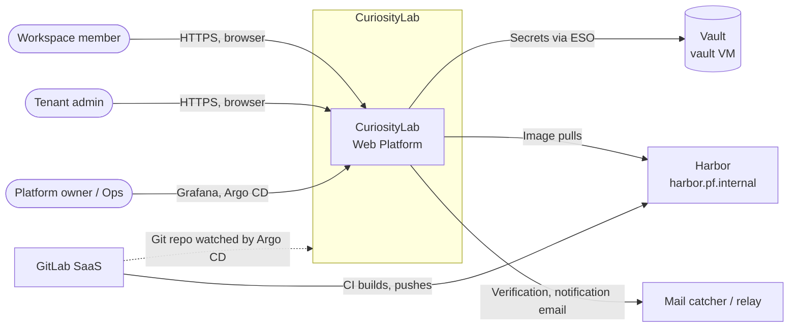
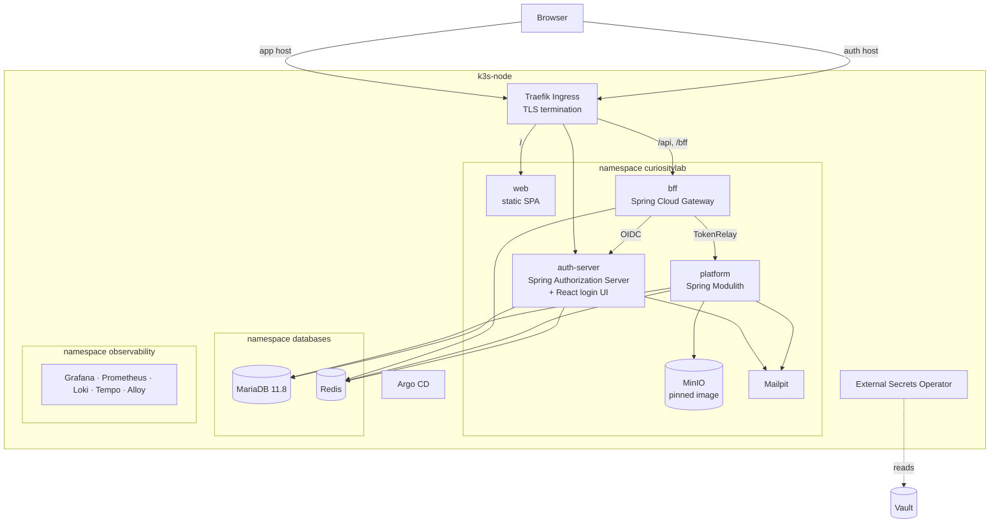
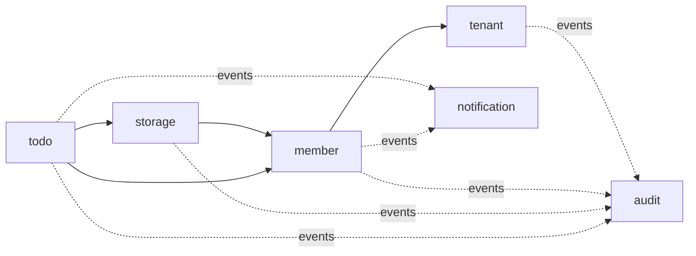
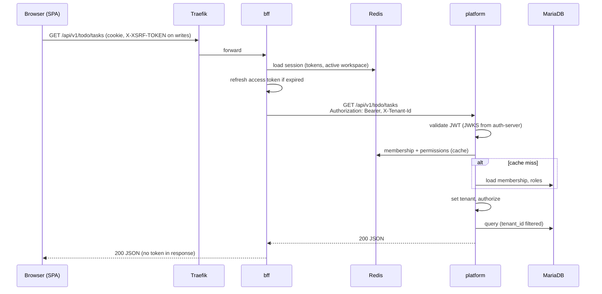

# CuriosityLab — Shared Architecture and Conventions

| Item | Value |
|---|---|
| Document | Shared kernel and cross-cutting conventions |
| Version | 0.1 (Draft) |
| Status | In review |
| Owner | Architect |
| Last updated | 2026-11-03 |
| Related | [`adr/`](adr/), [`../identity/architecture.md`](../identity/architecture.md), [`../bff/architecture.md`](../bff/architecture.md) |

> **Purpose.** This document describes only what is shared by every module and deployable: how modules are structured, how data, tenancy and events work, and how everything is built, deployed and observed. Module-specific design lives in each module's own `architecture.md`. **Why** a choice was made is recorded in an ADR. When a decision changes, a new ADR is written and this document is updated to match.

---

## Table of Contents

1. [Architecture Drivers](#1-architecture-drivers)
2. [System Context](#2-system-context)
3. [Containers](#3-containers)
4. [Technology Stack](#4-technology-stack)
5. [Backend Module Structure](#5-backend-module-structure)
6. [Frontend Structure](#6-frontend-structure)
7. [Data Architecture](#7-data-architecture)
8. [Key Flows](#8-key-flows)
9. [Security Architecture](#9-security-architecture)
10. [Deployment Architecture](#10-deployment-architecture)
11. [CI/CD and Delivery](#11-cicd-and-delivery)
12. [Observability](#12-observability)
13. [Backup and Recovery](#13-backup-and-recovery)
14. [Repository Layout](#14-repository-layout)
15. [ADR Index](#15-adr-index)
16. [Risks and Technical Debt](#16-risks-and-technical-debt)
17. [Open Items](#17-open-items)

---

## 1. Architecture Drivers

### 1.1 Key quality attributes

| Driver | Target |
|---|---|
| Teachability | Every design choice can be explained in one book chapter and traced to an ADR |
| Modularity | Module boundaries are verified by tests; a product module can be extracted into its own deployable without rewriting its callers |
| Security | Tokens never reach the browser; tenant isolation is proven by automated tests; no plaintext secrets anywhere |
| Auditability | Every security-relevant action is recorded, append-only |
| Operability by one person | Build, scan and deploy are fully automated through GitOps |
| Resource efficiency | The whole platform, including observability, fits on one 4 vCPU / 16 GB node |

### 1.2 Constraints

| Constraint | Source |
|---|---|
| Java 17, Spring Boot 4.x (Spring Framework 7, Spring Security 7) | Owner decision ([ADR-SHARED-0004](adr/0004-runtime-framework-and-build-versions.md)) |
| React + TypeScript + MUI for every UI, including the login UI | Owner decision ([ADR-SHARED-0013](adr/0013-react-for-all-user-interfaces.md)) |
| MariaDB 11.8 LTS | Owner decision ([ADR-SHARED-0005](adr/0005-mariadb-database-per-deployable-and-uuid-keys.md)) |
| Single-node K3S (`k3s-node`, 4 vCPU / 16 GB) shared with other lab workloads | Lab infrastructure |
| All images from Harbor (`harbor.pf.internal/lab`); TLS from the lab CA, never skipped | Lab policy |
| All Pod secrets from Vault through External Secrets Operator | Owner decision ([ADR-SHARED-0010](adr/0010-secrets-with-external-secrets-operator.md)) |
| Deploy only through Argo CD (GitOps) | Owner decision ([ADR-SHARED-0009](adr/0009-gitops-with-argo-cd.md)) |
| No outbound SMTP on port 25 (GCP) | Cloud provider limit |
| GitLab SaaS for source and CI | Lab infrastructure |

### 1.3 Architectural style

- **Modular monolith** (Spring Modulith) for business modules, plus two small edge deployables: `auth-server` and `bff` ([ADR-SHARED-0003](adr/0003-modular-monolith-with-three-deployables.md)).
- **Single-page application**, same origin as the API through the `bff`.
- **Event-driven** integration between modules with a transactional outbox ([ADR-SHARED-0008](adr/0008-event-driven-integration-with-jdbc-event-publication-registry.md)).
- **Shared-schema multi-tenancy** ([ADR-SHARED-0007](adr/0007-shared-schema-multi-tenancy.md)).
- **GitOps** for all deployments.

---

## 2. System Context



| External system | Interaction |
|---|---|
| Vault (`vault.asia-east1-b.c.brhuangj-playground.internal:8200`) | Source of every runtime secret, read by External Secrets Operator |
| Harbor (`harbor.pf.internal`, project `lab`) | Container registry; images pulled by the cluster pull robot |
| GitLab SaaS | Source control and CI; Argo CD watches the deployment manifests |
| Mail catcher (Mailpit) / outbound relay | Development and tutorial email; outbound relay is deferred (GCP blocks port 25) |
| Lab CA | Issues TLS certificates for all ingress hosts |

---

## 3. Containers



| Container | Responsibility | Detail |
|---|---|---|
| **web** | Serves the React SPA as static files | [§6](#6-frontend-structure) |
| **bff** | Browser session, token storage, routing to back-end services, CSRF, edge rate limiting | [`../bff/architecture.md`](../bff/architecture.md) |
| **auth-server** | Accounts, credentials, MFA, passkeys, OIDC provider, React login UI | [`../identity/architecture.md`](../identity/architecture.md) |
| **platform** | All business modules (member, tenant, audit, storage, notification, todo, …) | [§5](#5-backend-module-structure) |
| **MariaDB** | System of record; one database per deployable | [§7](#7-data-architecture) |
| **Redis** | Spring Session stores (bff session with OAuth2 tokens at rest; auth-server login session), caches (platform), rate-limit counters. Password from Vault via ESO; reachable only through `NetworkPolicy` | [ADR-BFF-0003](../bff/adr/0003-sessions-in-redis-with-spring-session.md) |
| **MinIO** | S3-compatible object storage, image pinned by digest | `storage/` (planned) |
| **Mailpit** | Captures all outbound email in the lab | — |
| **Traefik** | Ingress, TLS termination (K3S built-in) | [§10](#10-deployment-architecture) |

---

## 4. Technology Stack

Exact patch versions are pinned in `gradle/libs.versions.toml` and `web/package.json`. Major versions change only through an ADR.

| Layer | Technology |
|---|---|
| Language / runtime (backend) | Java 17 |
| Framework | Spring Boot 4.x, Spring Framework 7, Spring Security 7, Spring Modulith |
| Identity | Spring Authorization Server (line aligned with Spring Security 7) |
| Edge | Spring Cloud Gateway Server WebFlux, Spring Session Data Redis |
| Build | Gradle (Kotlin DSL), multi-project, version catalog |
| Persistence | Spring Data JPA, Hibernate 7, Flyway |
| Database | MariaDB 11.8 LTS (`UUID` and `VECTOR` types, vector index) |
| Cache / session | Redis |
| Object storage | MinIO (S3 API, pinned image) |
| API documentation | springdoc-openapi → `openapi.json` build artifact per deployable |
| Backend testing | JUnit 5, Spring Boot Test, Testcontainers (MariaDB, Redis, MinIO), Spring Modulith test support, ArchUnit |
| Frontend | TypeScript, React, MUI, Vite, router (TanStack Router or React Router, OI-10), TanStack Query, react-i18next (zh-TW first) |
| API client | Generated from `openapi.json` |
| Frontend testing | Vitest, React Testing Library, MSW |
| End-to-end testing | Playwright |
| Orchestration | K3S, Helm charts, Traefik |
| GitOps | Argo CD |
| Secrets | Vault + External Secrets Operator |
| Registry | Harbor |
| Observability | OpenTelemetry, Prometheus, Loki, Tempo, Grafana, Grafana Alloy |
| CI | GitLab CI |
| Public book | VitePress (`site/`), HackMD read-only mirror |

---

## 5. Backend Module Structure

### 5.1 Deployables

| Deployable | Kind | Modules |
|---|---|---|
| `auth-server` | Spring Boot app | identity only (see identity docs) |
| `bff` | Spring Boot app (reactive) | no business modules (see bff docs) |
| `platform` | Spring Modulith app | `shared`, `tenant`, `member`, `audit`, `storage`, `notification`, `todo`; later `drive`, `docs`, `mail`, `comms`, `ai` |

`backend/libs/commons` holds the few types used by more than one deployable (Problem Details model, tenant context type, OTel conventions). It must stay small; anything with business meaning belongs in a module.

### 5.2 Platform modules

Each top-level package under `com.curiositylab.platform` is a Spring Modulith application module. `ApplicationModules.of(PlatformApplication.class).verify()` runs in the test suite; a boundary violation fails the build.

| Module | Responsibility |
|---|---|
| `shared` | Shared kernel (OPEN module): base entity, tenant resolution, error model, clock, security helpers. No business logic. |
| `tenant` | Workspace lifecycle: create, settings, plan, suspend |
| `member` | Members of a workspace, departments, groups, roles, permissions, ABAC attributes, data scope |
| `audit` | Append-only audit records; listener only |
| `storage` | S3 abstraction, presigned upload, multipart, quotas |
| `notification` | In-app and email notifications; listener only |
| `todo` | Projects, tasks, subtasks |

### 5.3 Dependencies

Solid arrows are direct API calls; dashed arrows are application events.



Rules:

1. No cycles. `tenant` depends on nothing except `shared`.
2. `audit` and `notification` are **listeners only**. No module calls their write API directly, except synchronous audit where no business transaction exists (e.g. a rejected request).
3. Cross-module reactions to state changes use events.
4. A module reads only its own tables. Another module's data is reached through its public API.

### 5.4 Package layout inside a module

```
member/
├── MemberApi.java               # Public API (top-level package = exposed)
├── MemberSummary.java           # Public read model
├── events/                      # Published events (@NamedInterface)
│   └── MemberRoleChanged.java
└── internal/                    # Not accessible from other modules
    ├── domain/                  # Entities, value objects, domain rules
    ├── application/             # Use cases, transactions
    ├── persistence/             # Repositories
    └── web/                     # Controllers  /api/v1/members/...
```

- Pragmatic layering, not full hexagonal: the module boundary does the important work.
- Admin functions live in the module that owns the data. There is no `admin` module.

### 5.5 Event-driven integration

- Modules publish Spring application events inside the business transaction.
- The **Spring Modulith Event Publication Registry (JDBC)** stores each event in the same transaction (transactional outbox). Listeners run after commit; incomplete publications are resubmitted on startup and by a scheduled job.
- When a module is extracted to its own deployable, its events are externalized to a broker (later ADR).

See [ADR-SHARED-0008](adr/0008-event-driven-integration-with-jdbc-event-publication-registry.md).

### 5.6 API conventions

| Concern | Convention |
|---|---|
| Base path | `/api/v1/<module>`; tenant-admin endpoints under `/api/v1/admin/<module>` |
| Format | JSON; dates ISO-8601 with offset; IDs as UUID strings |
| Errors | RFC 9457 Problem Details; English `title`/`detail`; stable `code` field for the frontend |
| Tenant | Never in the URL or body. Resolved from the `X-Tenant-Id` header set by the bff and verified by platform ([ADR-BFF-0004](../bff/adr/0004-active-workspace-in-session.md)) |
| Concurrency | Optimistic locking (`@Version`) with `ETag` / `If-Match` where lost updates matter |
| Pagination | `page`, `size`, `sort`; response includes total count |
| Contract | `openapi.json` generated in CI; Swagger UI only outside production-like environments |

---

## 6. Frontend Structure

All UIs use React ([ADR-SHARED-0013](adr/0013-react-for-all-user-interfaces.md)). There are two bundles: the main SPA (`web/`) and the login UI served by `auth-server` (see identity docs).

```
web/src/
├── app/            # Router, providers, layouts, menu built from permissions
├── shared/
│   ├── api/        # Client and types generated from openapi.json (never edited)
│   ├── ui/         # Reusable MUI components
│   ├── auth/       # /bff/me bootstrap, session expiry handling
│   └── permission/ # Route guards, <Can permission="..."> component
├── modules/        # Mirrors backend modules: member/, storage/, todo/, ...
└── i18n/           # zh-TW first, en later
```

| Concern | Approach |
|---|---|
| Server state | TanStack Query; no global store for server data |
| Authentication | `HttpOnly` session cookie from the bff; the SPA never sees tokens |
| CSRF | Cookie-to-header token on every state-changing request ([ADR-BFF-0005](../bff/adr/0005-csrf-and-same-origin-spa-hosting.md)) |
| Permissions | Fetched from platform after login; used only to hide UI. Platform always enforces. |

---

## 7. Data Architecture

### 7.1 Databases

> Database per deployable is Proposed ([ADR-SHARED-0005](adr/0005-mariadb-database-per-deployable-and-uuid-keys.md)).

| Database | Owner | Content |
|---|---|---|
| `cl_auth` | `auth-server` | Accounts, credentials, MFA, passkeys, OAuth2 clients, authorizations |
| `cl_platform` | `platform` | All platform modules, event publication registry |

One MariaDB 11.8 instance in namespace `databases`. Each deployable has its own database user with rights only on its own database. See [ADR-SHARED-0005](adr/0005-mariadb-database-per-deployable-and-uuid-keys.md).

### 7.2 Table and key conventions

| Concern | Convention |
|---|---|
| Table names | Prefixed by module: `member_department`, `todo_task` |
| Primary keys | UUIDv7 generated in the application, stored as MariaDB `UUID` (UUIDv7 is Proposed, ADR-SHARED-0005). Framework tables (`oauth2_*`, WebAuthn) keep their own names and keys |
| Tenant column | `tenant_id UUID NOT NULL` on every tenant-scoped table, mapped with Hibernate `@TenantId` |
| Indexes | Every tenant-scoped unique or lookup index starts with `tenant_id` |
| Auditing columns | `created_at`, `created_by`, `updated_at`, `updated_by`, `version` |
| Soft delete | Per module decision, not a global rule |
| Time | Stored as UTC `DATETIME(6)`; converted at the edge |
| Vectors | MariaDB `VECTOR` type with vector index, used later by `ai` |

### 7.3 Multi-tenancy

- Shared schema, discriminator column ([ADR-SHARED-0007](adr/0007-shared-schema-multi-tenancy.md)).
- The tenant is resolved per request from the verified `X-Tenant-Id` header and stored in a request-scoped context; Hibernate's `CurrentTenantIdentifierResolver` reads it.
- Non-tenant tables (for example `tenant_tenant`, framework tables) are explicitly listed and reviewed.
- A dedicated test suite proves that a request in tenant A can never read or change tenant B's rows.

### 7.4 Schema migration

- Flyway per deployable, in `src/main/resources/db/migration`, immutable after merge.
- Expand-then-contract: every migration is backward compatible with the previous application version.
- No credentials or user data in migrations.

---

## 8. Key Flows

### 8.1 Authenticated API request



Login and logout flows are in [`../bff/architecture.md`](../bff/architecture.md) and [`../identity/architecture.md`](../identity/architecture.md).

---

## 9. Security Architecture

Cross-cutting controls only; authentication detail is in the identity and bff docs.

| Control | Implementation |
|---|---|
| Token exposure | Tokens live only in the bff session in Redis ([ADR-BFF-0001](../bff/adr/0001-backend-for-frontend-tokens-stay-server-side.md)) |
| Authorization | Deny by default; checked in each module's application layer; permissions resolved in platform, not carried in the JWT ([ADR-IDENTITY-0003](../identity/adr/0003-permissions-resolved-by-platform-not-in-jwt.md)) |
| Tenant isolation | Verified membership per request, Hibernate `@TenantId`, isolation test suite |
| Secrets | Vault → ESO → Kubernetes Secret → Spring config tree; nothing in Git, images or Helm values |
| TLS | All ingress hosts use certificates signed by the lab CA |
| Network | Default-deny `NetworkPolicy` in `curiositylab`; only listed flows allowed (flow list: OI-11) |
| Containers | Non-root, read-only root filesystem, dropped capabilities |
| Headers | CSP, HSTS, `X-Content-Type-Options`, `Referrer-Policy`, frame denial. The bff sets them on its own responses; the SPA page's CSP comes from `web` or a Traefik middleware (OI-13); `auth.<domain>` bypasses the bff, so auth-server applies its own headers and rate limits |
| Supply chain | Images from Harbor only, scanned (Harbor Trivy) before deploy |

---

## 10. Deployment Architecture

### 10.1 Namespaces

| Namespace | Content |
|---|---|
| `curiositylab` | web, bff, auth-server, platform, MinIO, Mailpit |
| `databases` | MariaDB 11.8 (existing namespace and backup jobs; the current 12.3 instance is replaced, OI-09), Redis |
| `observability` | Grafana, Prometheus, Loki, Tempo, Alloy |
| `argocd`, `external-secrets` | Existing platform components |

See [ADR-SHARED-0011](adr/0011-kubernetes-namespaces.md).

### 10.2 Ingress hosts

| Host (placeholder) | Target |
|---|---|
| `app.<domain>` | `/` → web; `/api`, `/bff` (incl. OAuth2 login paths moved under `/bff`) → bff; later `/ws` (WebSocket) → bff |
| `auth.<domain>` | auth-server (OIDC endpoints, login UI) |
| `grafana.<domain>` | Grafana |

Domain names and DNS records are an open item (OI-01); DNS changes go through the infra Terraform. The token issuer must be `https://auth.<domain>` both for the browser and for in-cluster callers (bff, platform JWKS): OI-12.

### 10.3 Resource budget

| Component | Memory (approx.) |
|---|---|
| Existing workloads (Argo CD, ESO, MariaDB, other namespaces, system) | ~3.2 GB |
| auth-server + bff + platform | ~1.8 GB |
| web, Mailpit | ~0.1 GB |
| Redis, MinIO | ~0.5 GB |
| Observability stack | ~2.5 GB |
| **Total** | **~8 GB of 16 GB** |

Every Pod sets requests and limits; CPU (4 vCPU) is the tighter resource. A CPU budget per Pod is still to be measured (OI-14).

---

## 11. CI/CD and Delivery

| Stage | Jobs | Blocking rule |
|---|---|---|
| `lint` | Gradle checks, ESLint, type check, Helm lint | Any error fails |
| `test` | Unit, Testcontainers integration, Modulith verify, tenant isolation suite, Vitest | Any failure fails |
| `security` | Secret scan, SAST, dependency scan | Threshold per ADR (Part 5 of the book) |
| `build` | Images for web, bff, auth-server, platform | — |
| `push` | Push to `harbor.pf.internal/lab` with commit SHA tag; record digest | — |
| `scan` | Harbor Trivy scan result gate | Critical fails |
| `deploy` | Update image digests in the GitOps manifests | — |

- Images are built once per commit and promoted by digest.
- CI never runs `helm upgrade` or `kubectl apply`; Argo CD syncs the manifests ([ADR-SHARED-0009](adr/0009-gitops-with-argo-cd.md)).

---

## 12. Observability

| Signal | Path |
|---|---|
| Metrics | Micrometer → Prometheus (scraped) → Grafana |
| Logs | Structured JSON to stdout → Alloy → Loki |
| Traces | OpenTelemetry (Spring Boot 4 support) → Alloy → Tempo |
| Correlation | Trace ID in every log line; request ID propagated by the bff |

- Logs never contain passwords, tokens, session IDs or secret values.
- Application logs are for troubleshooting; audit records are stored by the `audit` module with their own retention.

See [ADR-SHARED-0012](adr/0012-observability-with-grafana-stack.md).

---

## 13. Backup and Recovery

| Data | Method |
|---|---|
| MariaDB | Existing backup CronJobs in `databases`, extended to `cl_auth` and `cl_platform` |
| MinIO | Bucket mirror (method open, OI-04) |
| Redis | Not backed up: sessions are disposable; users log in again |
| Vault | Owned by the lab, outside this project |

---

## 14. Repository Layout

```
CuriosityLab/
├── backend/
│   ├── settings.gradle.kts
│   ├── gradle/libs.versions.toml
│   ├── auth-server/
│   ├── bff/
│   ├── platform/
│   ├── libs/commons/
│   └── tools/codegen/            # Not shipped at runtime
├── web/                          # React SPA
├── deploy/
│   ├── charts/<deployable>/      # One Helm chart per deployable
│   ├── argocd/                   # Argo CD Application manifests
│   └── envs/lab/values-*.yaml
├── docs/                         # This folder: internal, English
├── site/                         # Public book, VitePress, zh-TW first
├── scripts/changelog.sh          # Per-deployable changelog (ADR-SHARED-0014)
├── cliff.toml                    # git-cliff config shared by all deployables
└── .gitlab-ci.yml
```

Each deployable (`backend/auth-server`, `backend/bff`, `backend/platform`, `web`) has a generated `CHANGELOG.md` and its own tags `<deployable>/v<semver>` ([ADR-SHARED-0014](adr/0014-changelogs-per-deployable-with-git-cliff.md)).

---

## 15. ADR Index

See [`adr/README.md`](adr/README.md).

| ADR | Title | Status |
|---|---|---|
| [0001](adr/0001-record-architecture-decisions.md) | Record architecture decisions | Accepted |
| [0002](adr/0002-separate-engineering-docs-and-public-book.md) | Separate engineering docs and public book | Accepted |
| [0003](adr/0003-modular-monolith-with-three-deployables.md) | Modular monolith with three deployables | Accepted |
| [0004](adr/0004-runtime-framework-and-build-versions.md) | Runtime, framework and build versions | Accepted / Proposed (frontend versions) |
| [0005](adr/0005-mariadb-database-per-deployable-and-uuid-keys.md) | MariaDB 11.8, database per deployable, UUID keys | Accepted (MariaDB, UUID) / Proposed (UUIDv7, database per deployable) |
| [0006](adr/0006-spring-data-jpa-with-hibernate.md) | Spring Data JPA with Hibernate 7 | Accepted |
| [0007](adr/0007-shared-schema-multi-tenancy.md) | Shared-schema multi-tenancy | Accepted |
| [0008](adr/0008-event-driven-integration-with-jdbc-event-publication-registry.md) | Event-driven integration with JDBC Event Publication Registry | Accepted |
| [0009](adr/0009-gitops-with-argo-cd.md) | GitOps with Argo CD | Accepted |
| [0010](adr/0010-secrets-with-external-secrets-operator.md) | Secrets with External Secrets Operator | Accepted |
| [0011](adr/0011-kubernetes-namespaces.md) | Kubernetes namespaces | Accepted |
| [0012](adr/0012-observability-with-grafana-stack.md) | Observability with the Grafana stack | Accepted (Grafana stack) / Proposed (components) |
| [0013](adr/0013-react-for-all-user-interfaces.md) | React for all user interfaces | Accepted |
| [0014](adr/0014-changelogs-per-deployable-with-git-cliff.md) | Changelogs per deployable with git-cliff | Accepted (git-cliff per deployable) / Proposed (tag scheme, commit linting) |

---

## 16. Risks and Technical Debt

| Risk | Impact | Mitigation |
|---|---|---|
| Single node for everything | Node outage stops the platform and its observability | Accepted for a lab; backups off the node (OI-04) |
| Node shared with other lab workloads | Noisy neighbours, memory pressure | Requests/limits on every Pod; `ResourceQuota` on `curiositylab` |
| MinIO community edition no longer maintained | No security fixes | Image pinned by digest; all code behind the S3 API so the backend can be replaced |
| VMs stop at 23:00 | Scheduled jobs and backups at night do not run | Schedule jobs inside working hours; resubmission on startup |
| `shared` module grows into a dumping ground | Hidden coupling between modules | Review rule: no business logic in `shared`; ArchUnit check |
| MariaDB 12.3 → 11.8 is a downgrade | In-place upgrade impossible; existing data must be dumped and reloaded | Fresh 11.8 instance; logical dump/restore only if data must be kept (OI-09) |
| Accepted decisions rest on Proposed ones | ADR-SHARED-0007 and §9 depend on ADR-BFF-0004 and ADR-IDENTITY-0003 | Confirm those two ADRs before implementation; revisit dependants if they change |

---

## 17. Open Items

| ID | Item | Owner |
|---|---|---|
| OI-01 | Domain names and DNS records for `app`, `auth`, `grafana` hosts (Terraform) | Owner |
| OI-02 | TLS certificate source: lab CA certificates delivered through ESO, or cert-manager with Vault PKI | Owner |
| OI-03 | GitOps manifests in the monorepo (`deploy/`) or a separate deployment repo | Owner |
| OI-04 | Off-node backup target for MariaDB and MinIO | Owner |
| OI-05 | Where GitLab CI jobs run (shared SaaS runners or a self-hosted runner) | Owner |
| OI-06 | Redis: dedicated instance for CuriosityLab or shared with other lab workloads | Owner |
| OI-07 | Java 17 vs a newer LTS (21 or 25); book Part 1.3 covers Virtual Threads, final in Java 21 | Owner |
| OI-08 | Events between deployables: how auth-server security events (outbox `security_event` in `cl_auth`) reach `audit` in platform. See OI-IDN-03 | Architect |
| OI-09 | MariaDB 11.8: fresh instance replacing 12.3; whether any 12.3 data must be kept (dump/reload) | Owner |
| OI-10 | Frontend router: TanStack Router or React Router | Owner |
| OI-11 | `NetworkPolicy` allow-list: Traefik (`kube-system`) → apps, apps → `databases`, Alloy/Prometheus (`observability`), auth-server JWKS/UserInfo | Architect |
| OI-12 | Issuer URL and in-cluster path to auth-server (hairpin through Traefik vs explicit endpoint URIs). See OI-IDN-04, OI-BFF-04 | Architect |
| OI-13 | Who sets the SPA page CSP: `web` container or Traefik middleware. See OI-BFF-02 | Architect |
| OI-14 | CPU requests/limits budget per Pod on the 4 vCPU node | Architect |
| OI-15 | Source location of the login UI in the repository layout (§14). See OI-IDN-05 | Architect |
